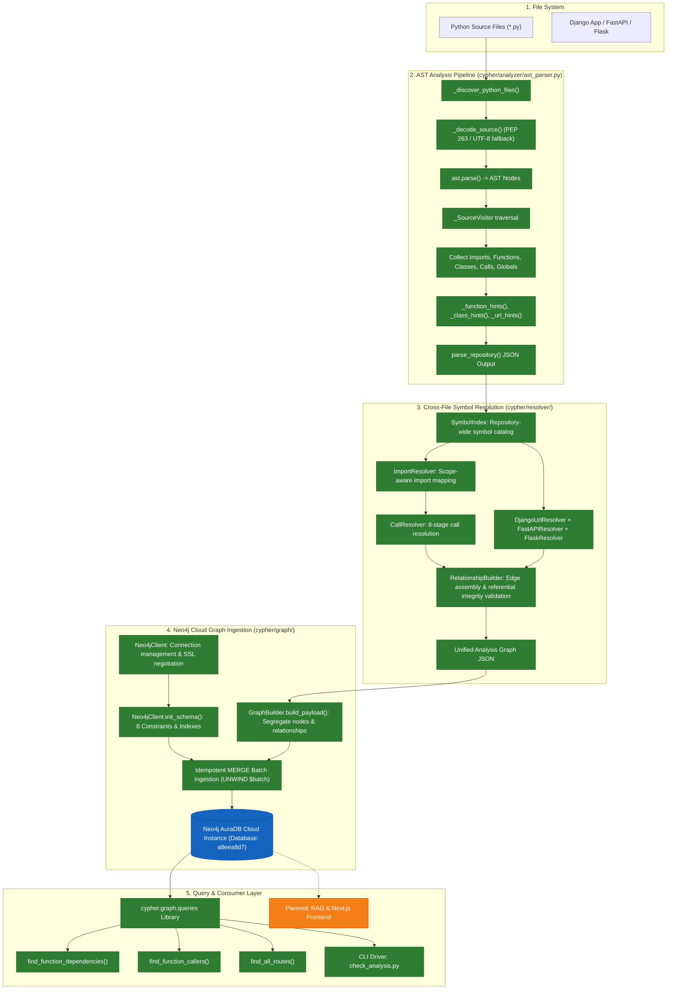
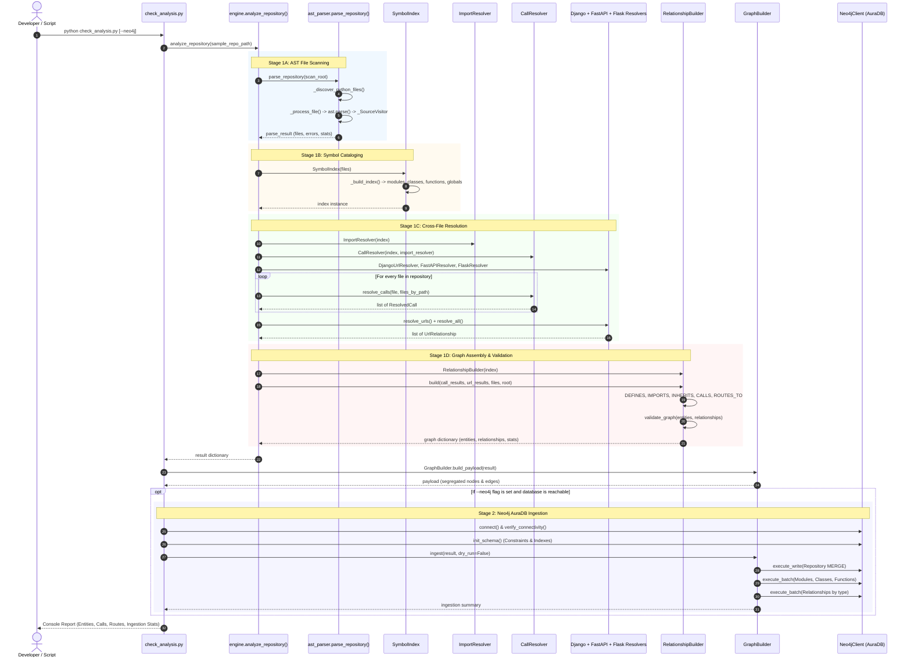
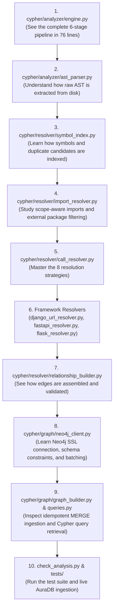

# Document 1: Cypher Project Map and End-to-End Execution Flow

> **Learning Series Navigation**
> - **Current Document**: [01: Project Map and End-to-End Flow](01-project-map-and-end-to-end-flow.md)
> - **Deep Dive Parser**: [02: AST Parser and Resolution Deep Dive](02-ast-parser-and-resolution-deep-dive.md)
> - **Graph & Database**: [03: Graph Builder, Neo4j, and Retrieval](03-graph-builder-neo4j-and-retrieval.md)

---

## Table of Contents
1. [Lesson 1: What Cypher Is](#lesson-1-what-cypher-is)
   - [Problems Cypher Solves](#problems-cypher-solves)
   - [What Cypher CAN Answer (With Real Examples)](#what-cypher-can-answer-with-real-examples)
   - [What Cypher CANNOT Answer (Static Analysis Boundaries)](#what-cypher-cannot-answer-static-analysis-boundaries)
   - [Current State vs. Future Architecture](#current-state-vs-future-architecture)
2. [Lesson 2: Architecture Overview](#lesson-2-architecture-overview)
   - [Complete End-to-End Pipeline Flowchart](#complete-end-to-end-pipeline-flowchart)
   - [Implemented vs. Planned Components](#implemented-vs-planned-components)
3. [Lesson 3: Complete Directory and File Map](#lesson-3-complete-directory-and-file-map)
   - [Repository Directory Tree](#repository-directory-tree)
   - [File Inventory: Role, Status, and Category](#file-inventory-role-status-and-category)
4. [Lesson 4: Execution Entry Point — Step by Step](#lesson-4-execution-entry-point--step-by-step)
   - [Execution Entry Points](#execution-entry-points)
   - [Mermaid Sequence Diagram of Pipeline Execution](#mermaid-sequence-diagram-of-pipeline-execution)
   - [Pipeline Function Calls in Chronological Order](#pipeline-function-calls-in-chronological-order)
   - [Data Evolution: Input to Output at Each Step](#data-evolution-input-to-output-at-each-step)
   - [Key Function Specifications (Mandatory Format)](#key-function-specifications-mandatory-format)
5. [Lesson 5: Complete Worked Example on `sample_repo`](#lesson-5-complete-worked-example-on-sample_repo)
   - [Target Repository Structure](#target-repository-structure)
   - [Execution Command](#execution-command)
   - [Actual Terminal Output Across Stages](#actual-terminal-output-across-stages)
   - [Graph Objects Created in Neo4j AuraDB](#graph-objects-created-in-neo4j-auradb)
6. [Lesson 6: Recommended Reading Order](#lesson-6-recommended-reading-order)
7. [Study Roadmap: 10 Hands-on Sessions](#study-roadmap-10-hands-on-sessions)

---

## Lesson 1: What Cypher Is

**Cypher** is a code intelligence platform that converts Python source code repositories into a semantic knowledge graph. It parses code into Abstract Syntax Trees (AST), indexes every module, class, and function across the entire repository, resolves cross-file relationships (imports, function calls, class inheritance, and web framework URL routing), and ingests the resulting structure into a **Neo4j AuraDB** graph database.

### Problems Cypher Solves
- **Mental Overload on Large Repositories**: Understanding how a 50,000-line legacy Python application connects across dozens of directories without manually reading thousands of lines. [Status: Implemented]
- **Silent Regression Risks During Refactoring**: Renaming or modifying a helper function in a low-level service file often breaks distant view handlers or background tasks that static grep cannot reliably trace. [Status: Implemented]
- **Endpoint to Data Flow Tracing**: In web applications (Django, FastAPI, Flask), routes are mapped via configuration (`urlpatterns`) or decorators (`@app.get`, `@bp.route`). Cypher links incoming HTTP requests directly to their controller handlers, service methods, and database models. [Status: Implemented]
- **Dead Code Identification**: Finding functions and methods that are never called internally and are not exposed via any public HTTP route or test suite. [Status: Implemented]
- **Multi-Repository Knowledge Base**: Querying relationships across multiple independent microservices or libraries using isolated graph workspaces within a single database instance. [Status: Implemented]

### What Cypher CAN Answer (With Real Examples)

| Query Category | Question Cypher Answers | Real Codebase Example | Verification Status |
| :--- | :--- | :--- | :--- |
| **Dependency Tracing** | *What internal functions and classes does function `X` call, directly or up to 3 hops deep?* | Calling `find_function_dependencies("users.views.user_list")` reveals it calls `users.services.list_users` (hop 1), which calls `users.repository.list_users` (hop 2). | **Runtime-verified** |
| **Impact Analysis** | *If I change function `Y`, which functions across all files will be affected?* | Calling `find_function_callers("users.repository.list_users")` identifies `users.services.list_users`, `users.repository.get_user_by_id`, and test suites. | **Runtime-verified** |
| **Route Discovery** | *What HTTP endpoints exist, what HTTP methods do they accept, and which function handles each?* | Calling `find_all_routes()` yields `users/<int:user_id>/` handled by `users.views.user_detail` (Django), and `[GET, PUT] '/<int:user_id>'` handled by `blueprints.users.user_detail` (Flask). | **Runtime-verified** |
| **OOP Hierarchy** | *What is the complete inheritance tree for class `Z`?* | Calling `find_class_hierarchy("users.models.Profile")` traces its superclass to `django.db.models.Model` (external dependency). | **Runtime-verified** |
| **Dead Code Detection** | *Which functions have zero incoming `CALLS` and zero incoming `ROUTES_TO` edges?* | Querying `DEAD_CODE_CANDIDATES_QUERY` identifies orphaned functions while excluding dunder methods (`__init__`) and tests (`test_*`). | **Tested** |
| **Architectural Boundaries** | *Which files import module `A`, and which external libraries does module `A` rely on?* | Tracing `(:Module)-[:IMPORTS]->(:Module)` relationships to detect cyclic dependencies or layer violations. | **Runtime-verified** |

### What Cypher CANNOT Answer (Static Analysis Boundaries)

Static analysis inspects code without executing it. Cypher respects clear theoretical boundaries:

1. **Dynamic Imports**: Imports constructed at runtime like `importlib.import_module(var)` or `__import__(name)` cannot be resolved statically because the value of `var` depends on runtime execution. [Status: Not implemented]
2. **Dynamic Attribute Lookup & Reflection**: Method invocations via `getattr(obj, method_name)()` or `eval(code_string)` cannot be connected to specific AST nodes unless the string literal is statically declared. [Status: Not implemented]
3. **Duck Typing / Dynamic Dispatch Without Construction**: If a function receives an unannotated argument `def process(worker): worker.execute()`, and `worker` was neither constructed locally nor annotated with a known class, Cypher classifies the call as `unresolved` (or `dynamic`) with candidate suggestions. [Status: Tested]
4. **Runtime Monkey-Patching**: Runtime overwrites like `services.list_users = custom_mock` during test runs are invisible to static AST visitors. [Status: Inferred]
5. **Runtime Database Queries**: Cypher analyzes the Python call graph; it does not execute SQL queries or inspect runtime database table schemas. [Status: Inferred]

### Current State vs. Future Architecture

| Dimension | Stage 1 & Stage 2 (Current State) | Stage 3 to 5 (Planned Roadmap) |
| :--- | :--- | :--- |
| **Code Representation** | Deterministic AST parsing (`ast_parser.py`) with lexical scoping | AST parser + Semantic Code Chunker with syntactic boundary preservation |
| **Symbol Resolution** | Scope-aware import maps, local constructor tracking, candidate disambiguation | Type-inference solver using PEP 484 type annotations and stub files |
| **Framework Support** | Django (`urlpatterns`, `include`), FastAPI (`APIRouter`, `include_router`), Flask (`Blueprint`, `register_blueprint`) | Celery canvas graphs, SQLAlchemy ORM mappings, Pytest fixture dependency injection |
| **Storage Layer** | Neo4j AuraDB (Enterprise Cloud) with unique constraints and indexes | Neo4j AuraDB (Graph) + Qdrant / Neo4j Vector Index (Embeddings) |
| **Retrieval Engine** | Deterministic Cypher queries via `cypher.graph.queries` | Hybrid Retrieval: Cypher Subgraph Traversal + Vector Similarity Search |
| **Intelligence** | Heuristic framework detectors | LLM Agentic Q&A (LangGraph / DeepSeek / Gemini) with RAG tool use |
| **User Interface** | CLI test scripts (`check_analysis.py`, `check_routes.py`) | Interactive Next.js 14 Web UI with Cytoscape/Force-Graph canvas |

---

## Lesson 2: Architecture Overview

### Complete End-to-End Pipeline Flowchart

The diagram below maps the complete data transformation lifecycle from raw source files on disk to graph queries in Neo4j AuraDB:



### Implemented vs. Planned Components

| Component / Layer | Module Path | Status | Operational Capabilities |
| :--- | :--- | :--- | :--- |
| **AST Parser** | `cypher/analyzer/ast_parser.py` | **Implemented** | Recursively scans files, handles file size limits, decodes encodings, extracts functions, classes, calls, globals, decorators, and framework hints. |
| **Analysis Engine** | `cypher/analyzer/engine.py` | **Implemented** | Top-level orchestrator function `analyze_repository()`. Coordinates parsing, indexing, resolvers, and graph assembly. |
| **Symbol Index** | `cypher/resolver/symbol_index.py` | **Implemented** | Repository-wide symbol catalog with duplicate candidate tracking and file-prioritized disambiguation. |
| **Import Resolver** | `cypher/resolver/import_resolver.py` | **Implemented** | Resolves bare and aliased imports with lexical scope awareness; distinguishes stdlib/third-party from broken internal imports. |
| **Call Resolver** | `cypher/resolver/call_resolver.py` | **Implemented** | 8 resolution strategies including same-module, imported symbols, self methods, class constructors, and instance method tracking (`service.get_users()`). |
| **Django URL Resolver** | `cypher/resolver/django_url_resolver.py` | **Implemented** | Extracts `path()`, `re_path()`, and `include()`, resolving URL patterns to view functions and nested `urls.py` modules. |
| **FastAPI Resolver** | `cypher/resolver/fastapi_resolver.py` | **Implemented** | Statically inspects `@app.get` / `@router.post` and extracts `include_router(..., prefix=...)` prefixes and target modules. |
| **Flask Resolver** | `cypher/resolver/flask_resolver.py` | **Implemented** | Resolves `@app.route` and `@bp.route` endpoints and extracts `register_blueprint(..., url_prefix=...)` prefixes. |
| **Relationship Builder** | `cypher/resolver/relationship_builder.py` | **Implemented** | Assembles unified JSON graph; synthesizes external dependency entities to ensure referential integrity; runs `validate_graph()`. |
| **Neo4j Client** | `cypher/graph/neo4j_client.py` | **Implemented** | Manages Bolt/Neo4j connections, SSL protocol negotiation (`neo4j+ssc://`), schema constraints, index creation, and transaction batches. |
| **Graph Builder** | `cypher/graph/graph_builder.py` | **Implemented** | Segregates JSON payloads into typed node and relationship batches; executes idempotent `MERGE` queries with `UNWIND $batch`. |
| **Query Library** | `cypher/graph/queries.py` | **Implemented** | Predefined parameterized Cypher queries and typed helper functions for call dependencies, reverse callers, routes, and dead code. |
| **RAG & Agent Service** | `cypher/services/` | **Planned** | LLM-powered conversational agent using hybrid graph and vector retrieval. |
| **REST API Server** | `cypher/api/routes.py` | **Planned** | FastAPI REST endpoints to expose graph queries to external clients. |
| **Interactive Web UI** | `frontend/` (or Next.js) | **Planned** | Visual interactive force-directed graph canvas displaying dependencies and route traces. |

---

## Lesson 3: Complete Directory and File Map

### Repository Directory Tree

```text
C:\Users\praty\OneDrive\01projects\minor_project\
├── .env                                # Local environment secrets (NEO4J URI, User, DB, Password)
├── .env.example                        # Template environment variables
├── .gitignore                          # Git ignore rules (.env, venvs, cache, sqlite)
├── check_analysis.py                   # Main CLI script: runs full analysis + dry-run/live Neo4j tests
├── check_parser.py                     # Debug script: prints raw AST parse output for sample_repo
├── check_routes.py                     # Debug script: prints resolved FastAPI and Flask routes
├── FRONTEND_PART_1.md                  # Design specifications for planned frontend UI
├── README.md                           # Project introduction and quickstart guide
├── requirements.txt                    # Python project dependencies
├── test.py                             # Ad-hoc experimental scratch script
├── cypher/                             # Core Cypher engine package
│   ├── __init__.py                     # Cypher package initialization
│   ├── config.py                       # Configuration constants placeholder
│   ├── main.py                         # Application CLI entry placeholder
│   ├── analyzer/                       # AST Parsing and analysis subsystem
│   │   ├── __init__.py                 # Subpackage initialization
│   │   ├── api_routes.py               # (Stub placeholder for route extraction)
│   │   ├── ast_parser.py               # AST visitor, file discovery, decoding, record emission
│   │   ├── engine.py                   # Orchestrator: runs pipeline from parse to relationship build
│   │   ├── function_calls.py           # (Stub placeholder for call visitor)
│   │   ├── imports.py                  # (Stub placeholder for import visitor)
│   │   └── url_extractor.py            # Extracts Django path() and include() call structures
│   ├── api/                            # Future REST API layer
│   │   ├── __init__.py                 # Subpackage initialization
│   │   └── routes.py                   # (Stub placeholder for FastAPI endpoints)
│   ├── graph/                          # Neo4j Graph Database Integration
│   │   ├── __init__.py                 # Subpackage initialization
│   │   ├── graph_builder.py            # Converts JSON analysis into Neo4j MERGE payloads
│   │   ├── neo4j_client.py             # Neo4j driver connection, SSL, schema, and transaction execution
│   │   └── queries.py                  # Predefined Cypher query templates and typed retrieval functions
│   ├── resolver/                       # Cross-file Symbol and Semantic Resolvers
│   │   ├── __init__.py                 # Subpackage initialization
│   │   ├── call_resolver.py            # 8-stage function/method call resolution engine
│   │   ├── django_url_resolver.py      # Resolves Django urlpatterns and include() targets
│   │   ├── fastapi_resolver.py         # Resolves FastAPI @app/@router routes and include_router()
│   │   ├── flask_resolver.py           # Resolves Flask @app/@bp routes and register_blueprint()
│   │   ├── import_resolver.py          # Scope-aware import alias resolution and external boundary check
│   │   ├── relationship_builder.py     # Graph entity assembler, edge builder, and referential validator
│   │   └── symbol_index.py             # Repository-wide symbol index with duplicate candidate tracking
│   └── services/                       # Future business services
│       └── __init__.py                 # Subpackage initialization
├── docs/                               # Project Documentation
│   ├── NEO4J_AURADB_GUIDE.md           # Guide for Neo4j AuraDB credentials and schema setup
│   ├── STAGE_1_DIAGNOSIS_AND_REMEDIATION.md # Comprehensive Stage 1 verification report (58 tests)
│   └── learning/                       # (Current Learning Documents Series)
│       ├── 01-project-map-and-end-to-end-flow.md
│       ├── 02-ast-parser-and-resolution-deep-dive.md
│       └── 03-graph-builder-neo4j-and-retrieval.md
├── sample_fastapi_repo/                # Verification Sample: FastAPI Project
│   ├── __init__.py                     # Package initialization
│   ├── main.py                         # FastAPI app definition with include_router(..., prefix="/users")
│   └── routers/
│       ├── __init__.py                 # Router subpackage
│       └── users.py                    # APIRouter with GET /, POST /, GET /{user_id}
├── sample_flask_repo/                  # Verification Sample: Flask Project
│   ├── __init__.py                     # Package initialization
│   ├── app.py                          # Flask app definition with register_blueprint(..., url_prefix="/users")
│   └── blueprints/
│       ├── __init__.py                 # Blueprint subpackage
│       └── users.py                    # Blueprint with GET /, POST /, GET/PUT /<int:user_id>
├── sample_repo/                        # Verification Sample: Full Django Project
│   ├── manage.py                       # Django CLI execution entry point
│   ├── db.sqlite3                      # Local SQLite database
│   ├── sample_project/                 # Django Root Project Configuration
│   │   ├── __init__.py
│   │   ├── asgi.py                     # ASGI configuration
│   │   ├── settings.py                 # Django settings
│   │   ├── urls.py                     # Root urlpatterns: includes accounts/ and users.urls
│   │   └── wsgi.py                     # WSGI configuration
│   ├── users/                          # Django Application
│   │   ├── admin.py                    # Admin model registration
│   │   ├── apps.py                     # AppConfig declaration
│   │   ├── forms.py                    # Form definitions
│   │   ├── models.py                   # Profile model inheriting from models.Model
│   │   ├── repository.py               # Data access layer (list_users, get_user_by_id)
│   │   ├── services.py                 # Business logic layer (list_users, create_user_with_profile)
│   │   ├── urls.py                     # App urlpatterns: routes to views
│   │   ├── views.py                    # View handlers (user_list, user_detail, profile_update)
│   │   ├── migrations/                 # Database migrations
│   │   └── tests/                      # Django unit tests
│   └── templates/                      # HTML templates
└── tests/                              # Automated Pytest Test Suite
    ├── __init__.py
    ├── test_ast_parser.py              # 12 tests: AST parsing, docstrings, calls, framework hints
    ├── test_fastapi_flask_resolver.py  # 15 tests: FastAPI & Flask routes, blueprints, HTTP methods
    ├── test_neo4j_graph.py             # 9 tests: Neo4j config, mock connectivity, batching, payloads
    ├── test_relationship_resolver.py   # 15 tests: Call resolution, imports, inheritance, stable IDs
    └── test_stage1_enhancements.py     # 7 tests: Instance methods, candidates, referential integrity
```

### File Inventory: Role, Status, and Category

| File Path | Category | Operational Purpose | Implementation Status |
| :--- | :--- | :--- | :--- |
| `cypher/analyzer/engine.py` | **Core** | Coordinates `parse_repository()`, `SymbolIndex()`, all resolvers, and `RelationshipBuilder()`. | **Implemented & Tested** |
| `cypher/analyzer/ast_parser.py` | **Core** | Parses Python AST, tracks scopes, collects calls/functions/classes, extracts framework hints. | **Implemented & Tested** |
| `cypher/analyzer/url_extractor.py` | **Core** | Extracts Django `path()`, `re_path()`, `include()` patterns from AST global assignments. | **Implemented & Tested** |
| `cypher/resolver/symbol_index.py` | **Core** | Indexes all modules, classes, functions; stores duplicate candidates; supports ambiguity checks. | **Implemented & Tested** |
| `cypher/resolver/import_resolver.py` | **Core** | Scope-aware import alias mapping; resolves dotted paths to entities or external packages. | **Implemented & Tested** |
| `cypher/resolver/call_resolver.py` | **Core** | Dispatches 8 resolution strategies to connect AST call sites with target function/class IDs. | **Implemented & Tested** |
| `cypher/resolver/django_url_resolver.py` | **Core** | Resolves Django URL routes to view functions (`ROUTES_TO`) and sub-urls (`INCLUDES`). | **Implemented & Tested** |
| `cypher/resolver/fastapi_resolver.py` | **Core** | Resolves FastAPI decorators and router inclusion with static prefix extraction. | **Implemented & Tested** |
| `cypher/resolver/flask_resolver.py` | **Core** | Resolves Flask route decorators and blueprint registration with static prefix extraction. | **Implemented & Tested** |
| `cypher/resolver/relationship_builder.py` | **Core** | Assembles final graph JSON, adds external dependency nodes, validates referential integrity. | **Implemented & Tested** |
| `cypher/graph/neo4j_client.py` | **Core** | Establishes SSL connection to Neo4j, enforces schema constraints/indexes, executes batches. | **Implemented & Runtime-verified** |
| `cypher/graph/graph_builder.py` | **Core** | Generates parameterized batches for nodes and edges; executes idempotent `MERGE` queries. | **Implemented & Runtime-verified** |
| `cypher/graph/queries.py` | **Core** | Library of parameterized Cypher retrieval queries for downstream agents and tools. | **Implemented & Tested** |
| `check_analysis.py` | **Tool / CLI** | End-to-end execution script verifying static analysis and dry-run/live Neo4j ingestion. | **Implemented & Runtime-verified** |
| `check_parser.py` | **Tool / Debug** | Dumps raw JSON parser output for `users/views.py`. | **Implemented** |
| `check_routes.py` | **Tool / Debug** | Dumps extracted routes from FastAPI and Flask sample repositories. | **Implemented** |
| `tests/test_ast_parser.py` | **Test** | 12 unit tests verifying AST parsing semantics, file discovery, and framework hints. | **Tested (12/12 passing)** |
| `tests/test_relationship_resolver.py` | **Test** | 15 unit tests verifying cross-file calls, imports, inheritance, and Django routes. | **Tested (15/15 passing)** |
| `tests/test_stage1_enhancements.py` | **Test** | 7 unit tests verifying instance method calls, duplicate candidates, and graph validation. | **Tested (7/7 passing)** |
| `tests/test_fastapi_flask_resolver.py` | **Test** | 15 unit tests verifying FastAPI and Flask route resolution and prefix extraction. | **Tested (15/15 passing)** |
| `tests/test_neo4j_graph.py` | **Test** | 9 unit tests verifying Neo4j config, mock client, batch execution, and payload structure. | **Tested (8/9 unit tests passing)** |

---

## Lesson 4: Execution Entry Point — Step by Step

### Execution Entry Points

Cypher provides two primary entry points depending on whether it is consumed as a library or executed from the command line:

1. **Programmatic / Library Entry Point**:
   - **File**: `cypher/analyzer/engine.py`
   - **Function**: `analyze_repository(root=None, max_file_size=None)` (lines 18–76)
   - **Signature**: `analyze_repository(root: Path | str | None = None, *, max_file_size: int | None = None) -> dict[str, Any]`

2. **CLI / Verification Entry Point**:
   - **File**: `check_analysis.py`
   - **Function**: `main()` (lines 124–155) calling `run_analysis(sample_repo_path, neo4j_live=False)` (lines 25–96)
   - **Execution Command**: `python check_analysis.py` or `python check_analysis.py --neo4j`

### Mermaid Sequence Diagram of Pipeline Execution



### Pipeline Function Calls in Chronological Order

1. **`check_analysis.py:main()`** [Line 124]
   - Parses `--neo4j` command-line argument.
   - Computes absolute paths for `sample_repo`, `sample_fastapi_repo`, and `sample_flask_repo`.
   - Calls `run_analysis(sample_repo, neo4j_live=args.neo4j)`.

2. **`check_analysis.py:run_analysis()`** [Line 25]
   - Prints banner and invokes `analyze_repository(sample_repo_path)`.

3. **`cypher/analyzer/engine.py:analyze_repository()`** [Line 18]
   - Normalizes path: `scan_root = Path(root).resolve()`.
   - **Step 1: Parse repository**:
     - Calls `parse_repository(scan_root, max_file_size=max_file_size)` in `cypher/analyzer/ast_parser.py` [Line 38].
     - Discovers files via `_discover_python_files()`.
     - Processes each file via `_process_file()`, decoding raw bytes with `_decode_source()`, parsing into AST via `ast.parse()`, executing `_SourceVisitor()`, and finalizing framework hints via `visitor.finalize()`.
     - Produces `parse_result` with keys: `"root"`, `"files"`, `"errors"`, `"stats"`.
   - **Step 2: Build Symbol Index**:
     - Constructs `index = SymbolIndex(files)` in `cypher/resolver/symbol_index.py` [Line 43].
     - Catalogs all modules, classes, functions, and globals into lookup maps.
   - **Step 3: Instantiate Resolvers**:
     - `import_resolver = ImportResolver(index)` [Line 46]
     - `call_resolver = CallResolver(index, import_resolver)` [Line 47]
     - `url_resolver = DjangoUrlResolver(index, import_resolver)` [Line 48]
     - `fastapi_resolver = FastAPIResolver(index, import_resolver)` [Line 49]
     - `flask_resolver = FlaskResolver(index, import_resolver)` [Line 50]
   - **Step 4: Resolve Calls**:
     - Iterates through `files` and calls `call_resolver.resolve_calls(f, files_by_path)` [Line 55].
     - Resolves internal calls using the 8-stage resolution strategy.
   - **Step 5: Resolve URLs**:
     - Resolves Django URLs via `url_resolver.resolve_urls(files)` [Line 58].
     - Appends FastAPI routes via `fastapi_resolver.resolve_all(files)` [Line 59].
     - Appends Flask routes via `flask_resolver.resolve_all(files)` [Line 60].
   - **Step 6: Build Graph Relationships & Validate**:
     - Calls `builder = RelationshipBuilder(index)` and `builder.build(...)` [Line 63].
     - Derives `DEFINES`, `DEFINES_METHOD`, `IMPORTS`, `INHERITS`, `CALLS`, `INSTANTIATES`, `ROUTES_TO`, `INCLUDES`.
     - Automatically generates `is_external=True` entities for external base classes and modules.
     - Runs `validate_graph(entities, relationships)` to verify zero dangling foreign keys.
     - Attaches diagnostics and error counts to `graph["stats"]`.
   - Returns complete graph dictionary.

4. **`check_analysis.py:run_analysis()` Resumed** [Line 33]
   - Prints stats summary (Entities, Relationships, Calls, Routes, Validation errors).
   - Instantiates `GraphBuilder()` and executes dry-run ingestion `builder.ingest(result, dry_run=True)` [Line 76].
   - If `--neo4j` was provided, instantiates `Neo4jClient()`, connects to AuraDB, initializes schema constraints via `client.init_schema()`, and runs live ingestion `builder.ingest(result, dry_run=False)`.

### Data Evolution: Input to Output at Each Step

```
Step 1: Input to parse_repository()
  scan_root: Path("C:/Users/praty/.../sample_repo")
    ↓
Step 2: Output of parse_repository()
  dict {
    "root": "C:/Users/.../sample_repo",
    "files": [ { "id": "file_123", "path": "users/views.py", "module": "users.views", "functions": [...], "calls": [...] } ],
    "stats": { "parsed_files": 22, "functions": 30, "classes": 12, "calls": 145 },
    "errors": []
  }
    ↓
Step 3: Output of SymbolIndex()
  self._by_id: dict { "func_abc": { "id": "func_abc", "qualified_name": "users.views.user_list", "kind": "function" } }
  self._by_qualified: dict { "users.views.user_list": {...} }
  self._by_qualified_candidates: dict { "users.views.user_list": [{...}] }
    ↓
Step 4: Output of CallResolver.resolve_calls()
  list[ResolvedCall(
    call_id="call_999", caller_qualified="users.views.user_list",
    callee_expression="services.list_users", resolved=True,
    target_entity_id="func_def456", target_qualified="users.services.list_users",
    method="imported_module_attribute", confidence="high"
  )]
    ↓
Step 5: Output of RelationshipBuilder.build()
  dict {
    "entities": [ 74 items: modules, classes, functions, external dependencies ],
    "relationships": [ 96 items: CONTAINS, DEFINES, IMPORTS, INHERITS, CALLS, ROUTES_TO, INCLUDES ],
    "stats": { "total_entities": 74, "total_relationships": 96, "validation_errors": 0 }
  }
    ↓
Step 6: Output of GraphBuilder.build_payload()
  dict {
    "repository": { "id": "repo_00c1b7a62dd618a9052b", "name": "sample_repo", "files_count": 22 },
    "nodes": { "modules": [22], "classes": [12], "functions": [30], "external_dependencies": [10] },
    "relationships": { "CONTAINS": [22], "DEFINES": [27], "CALLS": [21], "ROUTES_TO": [4], ... }
  }
    ↓
Step 7: Ingested into Neo4j AuraDB
  Database holds 75 Nodes (:Entity) and 118 Relationships
```

---

### Key Function Specifications (Mandatory Format)

### `analyze_repository(root, max_file_size)` — Pipeline Orchestrator

| Field | Detail |
| :--- | :--- |
| **Location** | `cypher/analyzer/engine.py` lines 18–76 |
| **Called by** | `check_analysis.py:run_analysis()`, `tests/test_relationship_resolver.py`, `tests/test_neo4j_graph.py` |
| **Calls** | `ast_parser.parse_repository()`, `SymbolIndex()`, `ImportResolver()`, `CallResolver()`, `DjangoUrlResolver()`, `FastAPIResolver()`, `FlaskResolver()`, `RelationshipBuilder.build()` |
| **Status** | Implemented / Tested / Runtime-verified |

**Purpose**: Runs the complete static analysis pipeline on a Python repository and returns a graph-ready JSON-serializable dictionary.

**Step-by-step**:
1. Resolves `scan_root` from the provided `root` argument or falls back to `Path.cwd()` (line 35).
2. Executes `parse_repository()` to collect raw AST file records, functions, classes, calls, and framework hints (lines 38–40).
3. Constructs repository-wide `SymbolIndex(files)` mapping IDs and qualified dotted paths (line 43).
4. Instantiates `ImportResolver`, `CallResolver`, `DjangoUrlResolver`, `FastAPIResolver`, and `FlaskResolver` (lines 46–50).
5. Loops over each file and resolves cross-file function/method calls via `call_resolver.resolve_calls()` (lines 53–55).
6. Resolves URL routing definitions across Django, FastAPI, and Flask resolvers (lines 58–60).
7. Invokes `RelationshipBuilder.build()` to assemble entities, structural relationships, call edges, and route edges, validating referential integrity (lines 63–69).
8. Attaches diagnostic warnings and scanned/failed file counts to `graph["stats"]` (lines 72–74) and returns the graph dictionary.

**Example**:
```python
# Input:
graph = analyze_repository("sample_repo")

# Output:
# graph.keys() -> dict_keys(['repository', 'entities', 'relationships', 'unresolved_references', 'diagnostics', 'stats'])
# graph["stats"]["total_entities"] -> 74
# graph["stats"]["total_relationships"] -> 96
# graph["stats"]["validation_errors"] -> 0
```

**What to remember**: `analyze_repository` never imports or executes scanned code; all analysis is performed through static AST evaluation.

**Verify yourself**:
```powershell
python -c "from cypher.analyzer.engine import analyze_repository; r = analyze_repository('sample_repo'); print(r['stats'])"
```

---

### `run_analysis(sample_repo_path, neo4j_live)` — Verification Runner

| Field | Detail |
| :--- | :--- |
| **Location** | `check_analysis.py` lines 25–96 |
| **Called by** | `check_analysis.py:main()` line 133 |
| **Calls** | `engine.analyze_repository()`, `GraphBuilder.build_payload()`, `GraphBuilder.ingest()`, `Neo4jClient()`, `queries.get_repository_overview()` |
| **Status** | Implemented / Tested / Runtime-verified |

**Purpose**: CLI test driver that runs static analysis on a target repository, prints human-readable verification reports, validates referential integrity, and tests dry-run/live Neo4j ingestion.

**Step-by-step**:
1. Invokes `analyze_repository(sample_repo_path)` and captures result dictionary (line 30).
2. Prints formatted JSON stats summary showing total entities, relationships, calls, and validation errors (lines 33–34).
3. Filters and prints the first 15 resolved `CALLS` edges with source, target, line number, and resolution strategy (lines 38–45).
4. Prints all `ROUTES_TO` relationships with HTTP methods, route strings, and handler functions (lines 46–55).
5. Prints all `INCLUDES` relationships showing parent-child routing boundaries (lines 56–64).
6. Checks `validation_errors`: prints `[SUCCESS]` if zero dangling references exist, or `[WARNING]` if referential integrity errors were found (lines 65–72).
7. Tests `GraphBuilder().ingest(result, dry_run=True)` and prints node and relationship breakdown counts (lines 74–79).
8. If `neo4j_live=True`, establishes live connection via `Neo4jClient()`, checks connectivity, executes live ingestion, and runs `get_repository_overview()` query (lines 81–95).

**Example**:
```python
# Input:
run_analysis(Path("sample_repo"), neo4j_live=False)

# Output:
# Prints STATS SUMMARY, CALLS (21), ROUTES_TO (4), INCLUDES (2), SUCCESS (0 errors), DRY-RUN Payload (75 nodes, 118 rels)
```

**What to remember**: `check_analysis.py` is the ultimate end-to-end smoke test for both Stage 1 (static analysis) and Stage 2 (Neo4j AuraDB integration).

**Verify yourself**:
```powershell
python check_analysis.py
```

---

## Lesson 5: Complete Worked Example on `sample_repo`

### Target Repository Structure

The `sample_repo` represents a standard production Django web application with clean architectural layering:
- **`sample_project/urls.py`**: Root URL configuration including Django auth URLs (`accounts/`) and `users.urls`.
- **`users/urls.py`**: App-level routes (`''`, `'users/new/'`, `'users/<int:user_id>/'`, `'users/<int:user_id>/edit/'`).
- **`users/views.py`**: Presentation controllers (`user_list`, `user_create`, `user_detail`, `profile_update`).
- **`users/services.py`**: Domain business logic (`list_users`, `get_user_detail`, `create_user_with_profile`).
- **`users/repository.py`**: Database access layer (`list_users`, `get_user_by_id`, `create_user`, `save_profile`).
- **`users/models.py`**: Relational models (`Profile` extending `models.Model`).

### Execution Command

```powershell
cd "C:\Users\praty\OneDrive\01projects\minor_project"
python check_analysis.py
```

### Actual Terminal Output Across Stages

```text
================================================================================
Running Cypher Static Analysis on: C:\Users\praty\OneDrive\01projects\minor_project\sample_repo
================================================================================

--- STATS SUMMARY ---
{
  "total_entities": 74,
  "entities_by_kind": {
    "class": 21,
    "function": 30,
    "module": 23
  },
  "total_relationships": 96,
  "relationships_by_type": {
    "CALLS": 21,
    "DEFINES": 27,
    "DEFINES_METHOD": 15,
    "IMPORTS": 12,
    "INCLUDES": 2,
    "INHERITS": 11,
    "INSTANTIATES": 4,
    "ROUTES_TO": 4
  },
  "unresolved_calls": 58,
  "external_calls": 66,
  "ambiguous_calls": 0,
  "validation_errors": 0,
  "scanned_files": 22,
  "failed_files": 0
}

--- CALLS RELATIONSHIPS (21) ---
  manage -> manage.main (line 16, method=same_module)
  users.repository.get_user_by_id -> users.repository.list_users (line 17, method=same_module)
  users.services.create_user_with_profile -> users.repository.create_user (line 39, method=imported_module_attribute)
  users.services.create_user_with_profile -> users.repository.get_or_create_profile (line 46, method=imported_module_attribute)
  users.services.create_user_with_profile -> users.repository.save_profile (line 47, method=imported_module_attribute)
  users.services.get_or_create_user_profile -> users.repository.get_or_create_profile (line 24, method=imported_module_attribute)
  users.services.get_or_create_user_profile -> users.services.get_user_detail (line 23, method=same_module)
  users.services.get_user_detail -> users.repository.get_user_by_id (line 15, method=imported_module_attribute)
  users.services.list_users -> users.repository.list_users (line 10, method=imported_module_attribute)
  users.services.update_user_profile -> users.repository.get_or_create_profile (line 55, method=imported_module_attribute)
  users.services.update_user_profile -> users.repository.save_profile (line 56, method=imported_module_attribute)
  users.services.update_user_profile -> users.services.get_user_detail (line 54, method=same_module)
  users.tests.test_services.UserServiceTests.test_create_user_with_profile -> users.services.create_user_with_profile (line 11, method=imported_module_attribute)
  users.tests.test_services.UserServiceTests.test_get_user_detail_raises_for_missing_user -> users.services.get_user_detail (line 34, method=imported_module_attribute)
  users.tests.test_services.UserServiceTests.test_list_users_returns_users_in_username_order -> users.services.list_users (line 28, method=imported_module_attribute)
  ... and 6 more CALLS

--- ROUTES_TO RELATIONSHIPS (4) ---
  users.urls (route: 'users/<int:user_id>/edit/' [name=profile_update]) -> users.views.profile_update (users/views.py)
  users.urls (route: 'users/new/' [name=user_create]) -> users.views.user_create (users/views.py)
  users.urls (route: 'users/<int:user_id>/' [name=user_detail]) -> users.views.user_detail (users/views.py)
  users.urls (route: '' [name=user_list]) -> users.views.user_list (users/views.py)

--- INCLUDES RELATIONSHIPS (2) ---
  sample_project.urls (prefix: 'accounts/') -> django.contrib.auth.urls (<external>)
  sample_project.urls -> users.urls (users/urls.py)

--- GRAPH REFERENTIAL INTEGRITY CHECK ---
  [SUCCESS] All relationships have valid, non-dangling source and target IDs in entities.

--- NEO4J INGESTION TEST ---
  [DRY-RUN] Ingestion Payload Ready:
    Nodes to MERGE        : 75 {'Repository': 1, 'Module': 22, 'Class': 12, 'Function': 30, 'ExternalDependency': 10}
    Relationships to MERGE: 118 {'CONTAINS': 22, 'DEFINES': 27, 'DEFINES_METHOD': 15, 'IMPORTS': 12, 'INHERITS': 11, 'CALLS': 21, 'INSTANTIATES': 4, 'ROUTES_TO': 4, 'INCLUDES': 2}
```

### Graph Objects Created in Neo4j AuraDB

When ingested into Neo4j AuraDB (instance `a8eea8d7`), the repository is represented by:

#### 1. Node Counts (Total: 75 Nodes)
- **`Repository:Entity` (1 node)**: Represents the top-level repository root (`repo_00c1b7a62dd618a9052b`).
- **`Module:Entity` (22 nodes)**: Each `.py` file (e.g. `users.views`, `users.services`, `sample_project.settings`).
- **`Class:Entity` (12 nodes)**: Class definitions (e.g. `users.models.Profile`, `users.tests.test_services.UserServiceTests`).
- **`Function:Entity` (30 nodes)**: Top-level functions and class methods (e.g. `users.views.user_list`, `users.repository.list_users`).
- **`ExternalDependency:Entity` (10 nodes)**: External base classes and modules (e.g. `django.db.models.Model`, `django.contrib.auth.urls`).

#### 2. Relationship Counts (Total: 118 Edges)
- **`CONTAINS` (22 edges)**: `(:Repository)-[:CONTAINS]->(:Module)` linking the repo to every parsed module file.
- **`DEFINES` (27 edges)**: `(:Module)-[:DEFINES]->(:Class|:Function)` for top-level definitions in files.
- **`DEFINES_METHOD` (15 edges)**: `(:Class)-[:DEFINES_METHOD]->(:Function)` linking classes to their instance methods.
- **`IMPORTS` (12 edges)**: `(:Module)-[:IMPORTS]->(:Module)` representing file-level internal imports.
- **`INHERITS` (11 edges)**: `(:Class)-[:INHERITS]->(:Class|:ExternalDependency)` tracking class hierarchies.
- **`CALLS` (21 edges)**: `(:Function)-[:CALLS]->(:Function)` representing verified internal function invocations.
- **`INSTANTIATES` (4 edges)**: `(:Function)-[:INSTANTIATES]->(:Class)` representing constructor invocations.
- **`ROUTES_TO` (4 edges)**: `(:Entity)-[:ROUTES_TO]->(:Function)` connecting URL patterns to controller handlers.
- **`INCLUDES` (2 edges)**: `(:Entity)-[:INCLUDES]->(:Module)` connecting root `urls.py` to sub-routing files.

---

## Lesson 6: Recommended Reading Order

To build a deep understanding of the Cypher codebase from the inside out, read the files in the following order:



1. **`cypher/analyzer/engine.py`**: Start here. In just 76 lines, `analyze_repository()` provides the clear mental roadmap of the entire analysis pipeline.
2. **`cypher/analyzer/ast_parser.py`**: Read the file discovery logic (`_discover_python_files`), encoding decoding (`_decode_source`), and the `_SourceVisitor` class to see how AST nodes become dictionaries.
3. **`cypher/resolver/symbol_index.py`**: Understand how all modules, classes, and functions are indexed into stable IDs, candidate lists, and dotted qualified names.
4. **`cypher/resolver/import_resolver.py`**: Study how `build_scoped_import_map` handles lexical scoping, and how `_COMMON_EXTERNALS` and `sys.stdlib_module_names` distinguish third-party libraries from internal symbols.
5. **`cypher/resolver/call_resolver.py`**: The most critical engine file. Study the 8 resolution strategies in order, paying special attention to `_resolve_instance_method()`.
6. **`cypher/resolver/django_url_resolver.py`**, **`fastapi_resolver.py`**, and **`flask_resolver.py`**: See how web framework routes are transformed into standardized `UrlRelationship` instances.
7. **`cypher/resolver/relationship_builder.py`**: See how all entities and relationships are merged, how external entities are created to prevent dangling edges, and how `validate_graph()` enforces referential integrity.
8. **`cypher/graph/neo4j_client.py`**: Learn how the official Neo4j Python driver connects over `neo4j+ssc://`, handles schema constraints, and executes batches.
9. **`cypher/graph/graph_builder.py` & `cypher/graph/queries.py`**: Inspect how JSON payloads are transformed into Cypher `MERGE` queries with `UNWIND $batch`, and how downstream queries retrieve subgraphs.
10. **`check_analysis.py` & `tests/`**: Run the test suite (`pytest tests/ -v`) and the live verification script to verify behavior hands-on.

---

## Study Roadmap: 10 Hands-on Sessions

Follow this structured 10-session roadmap to master, debug, and extend Cypher:

```mermaid
flowchart LR
    S1["Session 1:<br/>Environment & Smoke Test"] --> S2["Session 2:<br/>AST & Visitor Mechanics"]
    S2 --> S3["Session 3:<br/>Symbol Indexing"]
    S3 --> S4["Session 4:<br/>Scope-Aware Imports"]
    S4 --> S5["Session 5:<br/>Call Resolution Strategies"]
    S5 --> S6["Session 6:<br/>Framework Route Resolution"]
    S6 --> S7["Session 7:<br/>Graph Assembly & Validation"]
    S7 --> S8["Session 8:<br/>Neo4j Client & AuraDB"]
    S8 --> S9["Session 9:<br/>Idempotent Batch Ingestion"]
    S9 --> S10["Session 10:<br/>Cypher Retrieval & Dead Code"]
```



### Session 1: Environment Setup and Baseline Verification
- **Target Files**: `requirements.txt`, `check_analysis.py`, `.env.example`, `.env`
- **Functions to Study**: `check_analysis.py:main()`, `run_analysis()`
- **Commands to Run**:
  ```powershell
  python check_analysis.py
  python -m pytest tests/test_ast_parser.py -v
  ```
- **Hands-on Exercise**: Run `check_analysis.py`. Examine the printed JSON stats summary for `sample_repo` and confirm `validation_errors: 0`.

### Session 2: AST Node Traversal & Record Generation
- **Target Files**: `cypher/analyzer/ast_parser.py`
- **Functions to Study**: `parse_repository()`, `_SourceVisitor.visit_Call()`, `_SourceVisitor.visit_FunctionDef()`, `_SourceVisitor.finalize()`
- **Commands to Run**:
  ```powershell
  python check_parser.py
  ```
- **Hands-on Exercise**: Inspect the output of `check_parser.py` for `users/views.py`. Locate the raw call record for `services.list_users` and verify `receiver="services"`, `base_name="list_users"`, and `context="body"`.

### Session 3: Symbol Cataloging and Candidate Ambiguity
- **Target Files**: `cypher/resolver/symbol_index.py`
- **Functions to Study**: `SymbolIndex._build_index()`, `lookup_qualified()`, `lookup_candidates()`, `is_ambiguous()`
- **Commands to Run**:
  ```powershell
  python -m pytest tests/test_stage1_enhancements.py -k test_symbol_index_duplicate_qualified_names -v
  ```
- **Hands-on Exercise**: Write a small Python script creating two functions with the exact same name `def compute(): pass` in one file. Parse it with `parse_repository` and use `SymbolIndex.is_ambiguous()` to confirm both candidates are preserved.

### Session 4: Scope-Aware Import Resolution & Package Boundaries
- **Target Files**: `cypher/resolver/import_resolver.py`
- **Functions to Study**: `ImportResolver.resolve_import_alias()`, `build_scoped_import_map()`, `is_external()`
- **Commands to Run**:
  ```powershell
  python -m pytest tests/test_stage1_enhancements.py -k test_scope_aware_import_resolution -v
  ```
- **Hands-on Exercise**: In `sample_repo/users/views.py`, observe how `from . import services` resolves to module `users.services`. Trace how `import_resolver.is_external("django")` returns `True`.

### Session 5: The 8 Call Resolution Strategies
- **Target Files**: `cypher/resolver/call_resolver.py`
- **Functions to Study**: `CallResolver.resolve_calls()`, `_resolve_single_call()`, `_resolve_instance_method()`
- **Commands to Run**:
  ```powershell
  python -m pytest tests/test_stage1_enhancements.py -k test_instance_method_call_resolution -v
  python -m pytest tests/test_relationship_resolver.py -k test_cross_file_call -v
  ```
- **Hands-on Exercise**: Trace how `users.repository.get_user_by_id` calls `users.repository.list_users` via Strategy 1 (same-module), and how `service.get_users()` resolves via Strategy 4 (instance method).

### Session 6: Web Framework Route Discovery (Django, FastAPI, Flask)
- **Target Files**: `cypher/analyzer/url_extractor.py`, `cypher/resolver/django_url_resolver.py`, `fastapi_resolver.py`, `flask_resolver.py`
- **Functions to Study**: `DjangoUrlResolver.resolve_urls()`, `FastAPIResolver.resolve_routes()`, `FlaskResolver.resolve_routes()`
- **Commands to Run**:
  ```powershell
  python check_routes.py
  python -m pytest tests/test_fastapi_flask_resolver.py -v
  ```
- **Hands-on Exercise**: Inspect `check_routes.py`. Confirm how FastAPI `@app.get("/health")` and Flask `@app.route("/health")` extract HTTP methods and route strings without executing the web apps.

### Session 7: Graph Relationship Assembly & Referential Integrity
- **Target Files**: `cypher/resolver/relationship_builder.py`
- **Functions to Study**: `RelationshipBuilder.build()`, `validate_graph()`
- **Commands to Run**:
  ```powershell
  python -m pytest tests/test_stage1_enhancements.py -k test_graph_validation_referential_integrity -v
  ```
- **Hands-on Exercise**: Inspect how external class inheritance (`class Profile(models.Model)`) causes `RelationshipBuilder` to register an entity for `django.db.models.Model` with `is_external=True` so that the `INHERITS` edge never points to a dangling ID.

### Session 8: Neo4j AuraDB Connection Management & SSL Handshake
- **Target Files**: `cypher/graph/neo4j_client.py`
- **Functions to Study**: `Neo4jConfig`, `Neo4jClient.connect()`, `verify_connectivity()`, `init_schema()`
- **Commands to Run**:
  ```powershell
  python -m pytest tests/test_neo4j_graph.py -k test_neo4j_client -v
  ```
- **Hands-on Exercise**: Inspect `cypher/graph/neo4j_client.py`. Understand why `neo4j+ssc://` is required for Windows SSL certificate compatibility and how `init_schema()` creates the 8 constraints and indexes.

### Session 9: Idempotent Batch Ingestion with UNWIND
- **Target Files**: `cypher/graph/graph_builder.py`
- **Functions to Study**: `GraphBuilder.build_payload()`, `GraphBuilder.ingest()`
- **Commands to Run**:
  ```powershell
  python -m pytest tests/test_neo4j_graph.py -k test_graph_builder -v
  ```
- **Hands-on Exercise**: Run `python check_analysis.py`. Observe the `[DRY-RUN]` summary showing the exact node and edge counts prepared for Neo4j. If credentials are configured, run `python check_analysis.py --neo4j` to perform a live cloud ingestion.

### Session 10: Downstream Graph Retrieval Queries & Dead Code Tracing
- **Target Files**: `cypher/graph/queries.py`
- **Functions to Study**: `find_function_dependencies()`, `find_function_callers()`, `find_all_routes()`, `find_uncalled_functions()`, `get_repository_overview()`
- **Commands to Run**:
  ```powershell
  python -c "from cypher.graph.neo4j_client import Neo4jClient; from cypher.graph.queries import get_repository_overview; print(get_repository_overview(Neo4jClient()))"
  ```
- **Hands-on Exercise**: Write a custom script that queries Neo4j AuraDB to find all functions calling `users.repository.list_users` and verify the call chain through `users.services.list_users` to `users.views.user_list`.

---

> **Continue to Next Document**  
> Proceed to **[Document 2: AST Parser and Resolution Deep Dive](02-ast-parser-and-resolution-deep-dive.md)** for a line-by-line exploration of the AST visitor, lexical scope tracking, and the 8 call resolution strategies.
