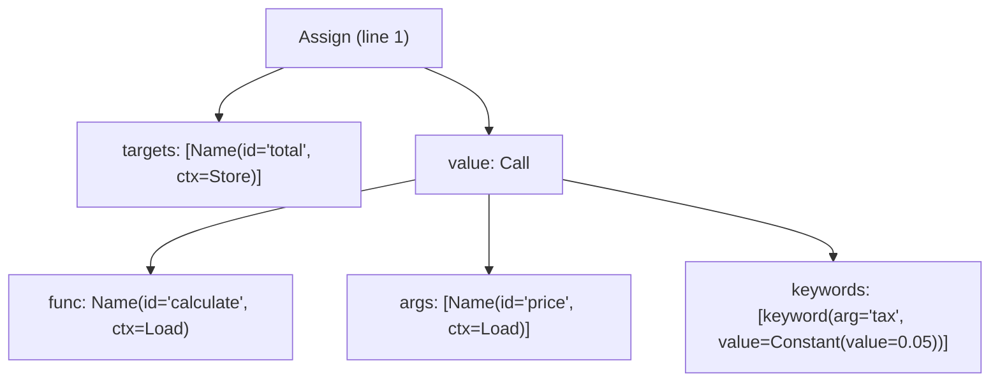
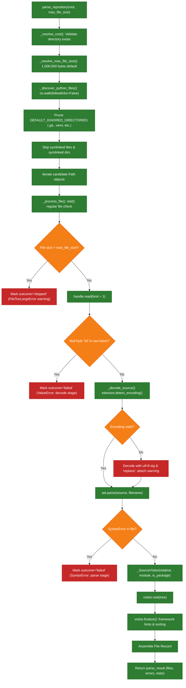
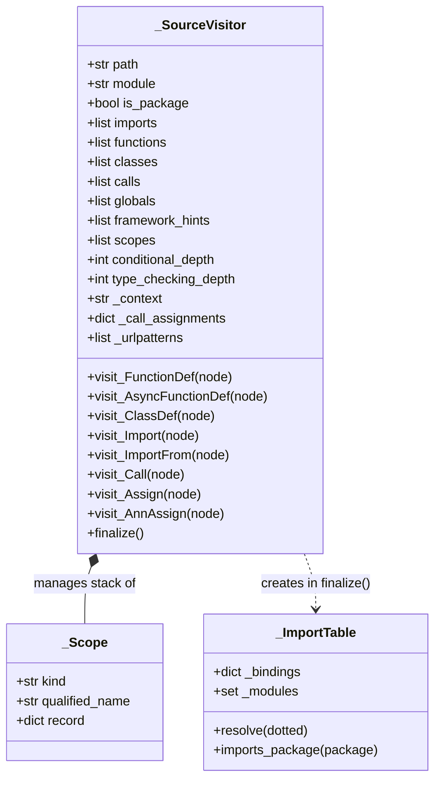
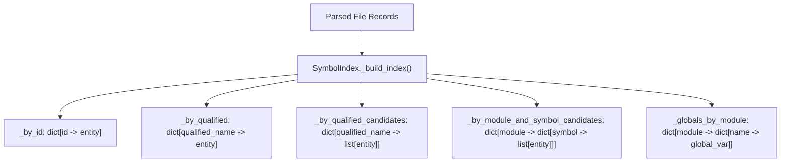
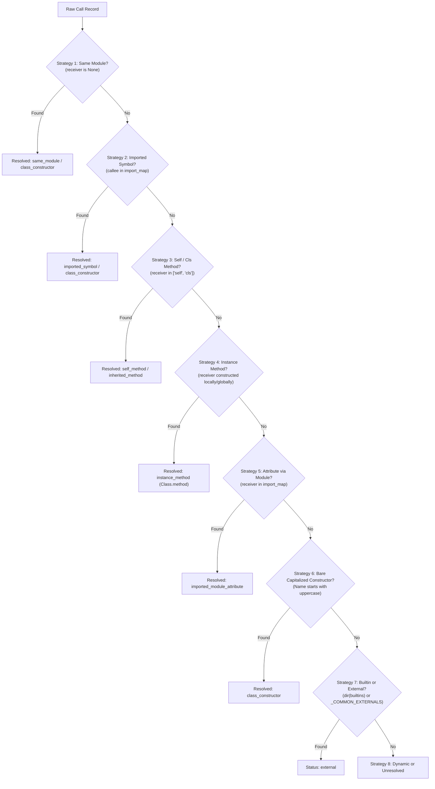

# Document 2: AST Parser and Cross-File Resolution Deep Dive

> **Learning Series Navigation**
> - **Architecture & Flow**: [01: Project Map and End-to-End Flow](01-project-map-and-end-to-end-flow.md)
> - **Current Document**: [02: AST Parser and Resolution Deep Dive](02-ast-parser-and-resolution-deep-dive.md)
> - **Graph & Database**: [03: Graph Builder, Neo4j, and Retrieval](03-graph-builder-neo4j-and-retrieval.md)

---

## Table of Contents
1. [Lesson 1: Python AST Fundamentals](#lesson-1-python-ast-fundamentals)
   - [What is an Abstract Syntax Tree?](#what-is-an-abstract-syntax-tree)
   - [Python's Built-in `ast` Module in Cypher](#pythons-built-in-ast-module-in-cypher)
   - [Key AST Node Types Used in Cypher](#key-ast-node-types-used-in-cypher)
2. [Lesson 2: Parser Entry — `parse_repository` and File Discovery](#lesson-2-parser-entry--parse_repository-and-file-discovery)
   - [The Discovery Pipeline](#the-discovery-pipeline)
   - [Functions in the Parser Pipeline (Mandatory Format)](#functions-in-the-parser-pipeline-mandatory-format)
3. [Lesson 3: The `_SourceVisitor` Class](#lesson-3-the-_sourcevisitor-class)
   - [Visitor Class Architecture and State Tracking](#visitor-class-architecture-and-state-tracking)
   - [Lexical Scope Stack (`scopes: list[_Scope]`)](#lexical-scope-stack-scopes-list_scope)
   - [The Context Label Stack (`_context`)](#the-context-label-stack-_context)
   - [Branch and Type Checking Tracking](#branch-and-type-checking-tracking)
   - [The `_ImportTable` Helper Class](#the-_importtable-helper-class)
4. [Lesson 4: Entity Extraction Mechanics](#lesson-4-entity-extraction-mechanics)
   - [Functions & Async Functions (`visit_FunctionDef`, `visit_AsyncFunctionDef`)](#functions--async-functions-visit_functiondef-visit_asyncfunctiondef)
   - [Class Definitions (`visit_ClassDef`)](#class-definitions-visit_classdef)
   - [Variable Assignments (`visit_Assign`, `visit_AnnAssign`, `visit_AugAssign`)](#variable-assignments-visit_assign-visit_annassign-visit_augassign)
   - [Visitor Finalization (`finalize()`)](#visitor-finalization-finalize)
5. [Lesson 5: Import Handling in Detail](#lesson-5-import-handling-in-detail)
   - [Relative Import Ascent Logic (`_resolve_import_module`)](#relative-import-ascent-logic-_resolve_import_module)
   - [The 5 Import Forms with Before/After Schema Records](#the-5-import-forms-with-beforeafter-schema-records)
   - [Multi-Alias and Star Import Representation](#multi-alias-and-star-import-representation)
6. [Lesson 6: Call Detection and Attribution](#lesson-6-call-detection-and-attribution)
   - [The `visit_Call` Traversal Logic](#the-visit_call-traversal-logic)
   - [Caller Attribution Across Scopes](#caller-attribution-across-scopes)
   - [Execution Context Categories](#execution-context-categories)
   - [Raw Call Record Schema](#raw-call-record-schema)
7. [Lesson 7: Symbol Index and Resolution Pipeline](#lesson-7-symbol-index-and-resolution-pipeline)
   - [SymbolIndex Architecture and Candidate Disambiguation](#symbolindex-architecture-and-candidate-disambiguation)
   - [ImportResolver: Scope-Aware Alias Resolution](#importresolver-scope-aware-alias-resolution)
   - [CallResolver: The 8 Resolution Strategies](#callresolver-the-8-resolution-strategies)
   - [End-to-End Call Resolution Trace](#end-to-end-call-resolution-trace)
8. [Lesson 8: Framework Detection Systems](#lesson-8-framework-detection-systems)
   - [Heuristic Framework Hint Extraction](#heuristic-framework-hint-extraction)
   - [Confidence Ratings and Evidence Chains](#confidence-ratings-and-evidence-chains)
   - [Framework-Specific Resolvers (Django, FastAPI, Flask)](#framework-specific-resolvers-django-fastapi-flask)
9. [Lesson 9: Complete Parser Output Schema](#lesson-9-complete-parser-output-schema)
   - [JSON Schema of `parse_repository()`](#json-schema-of-parse_repository)
   - [JSON Schema of `RelationshipBuilder.build()`](#json-schema-of-relationshipbuilderbuild)
10. [Lesson 10: Tests, Verification, and Edge Cases](#lesson-10-tests-verification-and-edge-cases)
    - [Behaviors Covered in Test Suite](#behaviors-covered-in-test-suite)
    - [Static Analysis Edge Cases Handled](#static-analysis-edge-cases-handled)
    - [Fundamental Static Analysis Limitations](#fundamental-static-analysis-limitations)

---

## Lesson 1: Python AST Fundamentals

### What is an Abstract Syntax Tree?

When the Python interpreter or Cypher reads source code, it first transforms character streams into tokens (lexical analysis) and then organizes those tokens into a tree of syntactical constructs called an **Abstract Syntax Tree (AST)**.

For example, consider this simple Python assignment and call:
```python
total = calculate(price, tax=0.05)
```

Python's `ast` module parses this into the following tree structure:



In an AST:
- **Comments and formatting** are discarded (though line numbers and column offsets are retained).
- **Semantics are explicit**: an assignment is clearly separated from an expression, a positional argument from a keyword argument, and a function definition from a function call.

### Python's Built-in `ast` Module in Cypher

Cypher utilizes Python's standard library `ast` module without external compiler dependencies. The core tools utilized are:
1. `ast.parse(source, filename=path)`: Compiles Python source code into a root `ast.Module` node. [Status: Implemented]
2. `ast.NodeVisitor`: The base class providing the visitor pattern. Subclasses define `visit_<NodeType>(self, node)` methods to intercept specific node kinds. [Status: Implemented]
3. `ast.unparse(node)`: Converts AST expression subtrees back into canonical Python source strings (e.g. converting an `Attribute` node back into `"users.services.list_users"`). [Status: Implemented]
4. `ast.literal_eval(node)`: Safely evaluates compile-time literal values (strings, numbers, tuples, dicts) without executing code. [Status: Implemented]
5. `ast.walk(node)`: Traverses AST subtrees recursively in an unspecified order (used for shallow expression inspection). [Status: Implemented]

### Key AST Node Types Used in Cypher

| AST Node Class | Python Code Construct | Cypher Extracted Role |
| :--- | :--- | :--- |
| `ast.FunctionDef` | `def process(x): ...` | Synchronous function entity, arguments, docstring, decorator list |
| `ast.AsyncFunctionDef` | `async def fetch(): ...` | Asynchronous function entity, marked with `kind="async_function"` |
| `ast.ClassDef` | `class Profile(Model): ...` | Class entity, base classes, metaclass keywords, decorators, methods |
| `ast.Import` | `import os, sys as system` | Absolute module imports and aliases |
| `ast.ImportFrom` | `from users.models import Profile` | Imported symbols, relative ascent levels (`.`, `..`), star imports |
| `ast.Call` | `service.list_users(limit=10)` | Function call sites, receiver expression, arguments, keywords |
| `ast.Assign` | `app = FastAPI()`, `x = 1` | Module globals, class attributes, function local assignments |
| `ast.AnnAssign` | `service: UserService = ...` | Type-annotated variable assignments |
| `ast.AugAssign` | `urlpatterns += [...]` | In-place operators (tracks Django `urlpatterns` extensions) |
| `ast.If` | `if TYPE_CHECKING: ...` | Tracks conditional depth and type-checking branch isolation |
| `ast.Try` / `ast.TryStar` | `try: import x except: ...` | Tracks conditional depth during optional imports |
| `ast.Lambda` | `lambda item: convert(item)` | Anonymous function entity with synthetic name `<lambda:N>` |

---

## Lesson 2: Parser Entry — `parse_repository` and File Discovery

### The Discovery Pipeline

The parser entry point is `parse_repository()`. It discovers, filters, decodes, parses, and traverses every valid Python source file in the repository without executing any scanned code:



---

### Functions in the Parser Pipeline (Mandatory Format)

### `_resolve_root(root)` — Repository Root Normalizer

| Field | Detail |
| :--- | :--- |
| **Location** | `cypher/analyzer/ast_parser.py` lines 1126–1143 |
| **Called by** | `parse_repository()` line 1370 |
| **Calls** | `Path.expanduser()`, `Path.resolve()`, `Path.exists()`, `Path.is_dir()` |
| **Status** | Implemented / Tested |

**Purpose**: Resolves the target repository directory to an absolute `Path`, verifying that it exists and is a directory.

**Step-by-step**:
1. If `root` is `None`, defaults to the `sample_repo` directory located beside the Cypher package (lines 1127–1129).
2. Expands user home directories (`~`) and resolves symlinks to an absolute path (line 1131).
3. Asserts `scan_root.exists()`, raising `NotADirectoryError` if missing (lines 1133–1137).
4. Asserts `scan_root.is_dir()`, raising `NotADirectoryError` if a file path was passed (lines 1138–1142).
5. Returns validated `Path` object (line 1143).

**Example**:
```python
# Input:
_resolve_root("sample_repo")
# Output:
# WindowsPath('C:/Users/praty/OneDrive/01projects/minor_project/sample_repo')
```

**What to remember**: Prevents scanning files when given invalid directories; fails immediately with an informative message.

**Verify yourself**:
```python
import pytest
from cypher.analyzer.ast_parser import _resolve_root
with pytest.raises(NotADirectoryError):
    _resolve_root("non_existent_folder_xyz")
```

---

### `_discover_python_files(scan_root)` — Safe Directory Walker

| Field | Detail |
| :--- | :--- |
| **Location** | `cypher/analyzer/ast_parser.py` lines 1173–1216 |
| **Called by** | `parse_repository()` line 1386 |
| **Calls** | `os.walk(followlinks=False)`, `_count_python_files()`, `_display_path()`, `_error()` |
| **Status** | Implemented / Tested |

**Purpose**: Traverses the directory tree to find Python files, strictly pruning ignored directories and avoiding symlink traversal cycles.

**Step-by-step**:
1. Initializes `candidates = []`, `skipped = 0`, and `errors = []` (lines 1179–1181).
2. Defines `on_error(exc)` handler to capture directory read permission errors under `stage="discovery"` without crashing (lines 1183–1191).
3. Invokes `os.walk(scan_root, topdown=True, followlinks=False)` (lines 1193–1195).
4. Modifies `directories[:]` in place: skips symlinked directories (to prevent infinite loops) and counts skipped `.py` files inside `DEFAULT_IGNORED_DIRECTORIES` (`.venv`, `venv`, `node_modules`, `.git`, `__pycache__`, `build`, `dist`) (lines 1198–1206).
5. Filters `filenames`: checks `.endswith(".py")`, skips symlinked files (incrementing `skipped`), and appends valid regular files to `candidates` (lines 1208–1215).
6. Returns `(candidates, skipped, errors)` tuple (line 1216).

**Example**:
```python
# Input:
# Directory with 22 Python files in sample_repo and 500 files in venv/
candidates, skipped, errors = _discover_python_files(Path("sample_repo"))
# Output:
# len(candidates) -> 22, skipped -> 0, errors -> []
```

**What to remember**: `os.walk` in-place slicing (`directories[:] = kept`) completely avoids recursing into `venv` or `node_modules`, keeping scans fast.

**Verify yourself**:
```python
from pathlib import Path
from cypher.analyzer.ast_parser import _discover_python_files
candidates, skipped, errors = _discover_python_files(Path("sample_repo"))
print(f"Found {len(candidates)} candidates, skipped {skipped}")
```

---

### `_decode_source(raw)` — Encoding-Resilient Byte Decoder

| Field | Detail |
| :--- | :--- |
| **Location** | `cypher/analyzer/ast_parser.py` lines 1226–1248 |
| **Called by** | `_process_file()` line 1298 |
| **Calls** | `tokenize.detect_encoding()`, `raw.decode()` |
| **Status** | Implemented / Tested |

**Purpose**: Decodes raw source bytes into a Python string, honoring PEP 263 encoding declarations (e.g. `# -*- coding: utf-8 -*-`) and falling back cleanly on invalid characters.

**Step-by-step**:
1. Passes `io.BytesIO(raw).readline` to `tokenize.detect_encoding()` to check for BOM or PEP 263 headers (line 1236).
2. If detection succeeds, attempts decoding via the declared codec. If clean, returns `_DecodedSource(text, encoding, False, [])` (lines 1240–1241).
3. If decoding fails or declared encoding is unknown, falls back to `_FALLBACK_ENCODING` (`"utf-8-sig"`) with replacement mode `errors="replace"` (line 1245).
4. Appends a warning diagnostic documenting the codec failure and replacement action (line 1246).
5. Returns `_DecodedSource(text, "utf-8-sig", True, [warning])` (line 1247).

**Example**:
```python
# Input:
# Bytes containing invalid UTF-8 byte 0xff
decoded = _decode_source(b"\xff")
# Output:
# decoded.used_fallback -> True
# decoded.warnings[0][0] -> 'UnicodeDecodeError'
# decoded.text -> '\ufffd'
```

**What to remember**: Files with corrupt characters never crash the parser; they are decoded with replacement characters `\ufffd` and flagged with a warning diagnostic.

**Verify yourself**:
```python
from cypher.analyzer.ast_parser import _decode_source
res = _decode_source(b"# -*- coding: utf-8 -*-\nprint('hello')\n")
assert res.encoding == "utf-8" and not res.used_fallback
```

---

### `_process_file(path, scan_root, max_file_size)` — Per-File Analyzer

| Field | Detail |
| :--- | :--- |
| **Location** | `cypher/analyzer/ast_parser.py` lines 1256–1338 |
| **Called by** | `parse_repository()` line 1393 |
| **Calls** | `path.stat()`, `path.open()`, `_decode_source()`, `_module_name()`, `ast.parse()`, `_SourceVisitor()`, `visitor.visit()`, `visitor.finalize()` |
| **Status** | Implemented / Tested / Runtime-verified |

**Purpose**: Reads, validates, decodes, parses, and traverses a single Python file, returning a structured file record or diagnostic errors.

**Step-by-step**:
1. Computes relative POSIX path: `relative = path.relative_to(scan_root).as_posix()` (line 1257).
2. Calls `path.stat()` to verify regular file status (`stat.S_ISREG`) and check file size against `max_file_size` (lines 1277–1286).
3. Opens file in binary mode and reads up to `max_file_size + 1` bytes; skips if file exceeded limit while growing (lines 1288–1294).
4. Inspects for null byte `b"\0"`; if found, aborts with `ValueError` under `stage="decode"` (line 1295).
5. Decodes bytes using `_decode_source()` and attaches any decoding warnings (lines 1298–1300).
6. Computes module dotted name and package status via `_module_name()` (lines 1303–1306).
7. Compiles source string into AST via `ast.parse(source, filename=relative)`. Catches `SyntaxError` and returns `outcome="failed"` with exact line/offset (lines 1307–1311).
8. Instantiates `_SourceVisitor(relative, module, is_package)`, calls `visitor.visit(tree)`, and runs `visitor.finalize()` (lines 1313–1316).
9. Assembles complete record dict (stable ID, path, module, sha256, docstring, imports, functions, classes, calls, globals, framework_hints) and returns `_FileResult("parsed", record, diagnostics)` (lines 1320–1337).

**Example**:
```python
# Input:
result = _process_file(Path("sample_repo/users/views.py"), Path("sample_repo"), 1_000_000)
# Output:
# result.outcome -> 'parsed'
# result.record["module"] -> 'users.views'
# len(result.record["functions"]) -> 4
```

**What to remember**: `_process_file` is completely sandboxed: syntax errors, null bytes, or oversized files are logged as diagnostics while remaining files continue parsing.

**Verify yourself**:
```python
from pathlib import Path
from cypher.analyzer.ast_parser import _process_file
res = _process_file(Path("sample_repo/manage.py"), Path("sample_repo"), 1_000_000)
assert res.outcome == "parsed" and res.record["module"] == "manage"
```

---

### `parse_repository(root, max_file_size)` — Primary Public Parser API

| Field | Detail |
| :--- | :--- |
| **Location** | `cypher/analyzer/ast_parser.py` lines 1345–1427 |
| **Called by** | `engine.analyze_repository()` line 38 |
| **Calls** | `_resolve_root()`, `_resolve_max_file_size()`, `_discover_python_files()`, `_process_file()` |
| **Status** | Implemented / Tested / Runtime-verified |

**Purpose**: Scans an entire directory tree without executing code, producing sorted, JSON-serializable file AST records, diagnostic error lists, and aggregate statistics.

**Step-by-step**:
1. Resolves `scan_root` and `limit` bytes via `_resolve_root` and `_resolve_max_file_size` (lines 1370–1371).
2. Initializes `files = []`, `errors = []`, and aggregate `stats` dictionary (lines 1373–1384).
3. Discovers candidate files via `_discover_python_files()`, recording skipped file counts and directory read errors (lines 1386–1388).
4. Iterates through sorted candidate paths and invokes `_process_file()` on each (lines 1392–1393).
5. Accumulates diagnostics into `errors` and increments `stats` (`parsed_files`, `failed_files`, `skipped_files`, `functions`, `classes`, `imports`, `calls`) (lines 1394–1411).
6. Deterministically sorts `files` by path and `errors` by path, line, and message (lines 1413–1421).
7. Returns dictionary: `{"root": str(scan_root), "files": files, "errors": errors, "stats": stats}` (lines 1422–1427).

**Example**:
```python
# Input:
res = parse_repository("sample_repo")
# Output:
# res["stats"] -> {'scanned_files': 22, 'parsed_files': 22, 'failed_files': 0, 'skipped_files': 0, 'functions': 30, 'classes': 12, 'imports': 38, 'calls': 145}
```

**What to remember**: Output is 100% deterministic and JSON-serializable; repeated runs on unchanged repositories yield bit-for-bit identical JSON.

**Verify yourself**:
```powershell
python -c "from cypher.analyzer.ast_parser import parse_repository; r = parse_repository('sample_repo'); print(r['stats'])"
```

---

## Lesson 3: The `_SourceVisitor` Class

### Visitor Class Architecture and State Tracking

The `_SourceVisitor` class (`cypher/analyzer/ast_parser.py`, lines 335–1086) extends `ast.NodeVisitor` to collect definitions, imports, calls, assignments, and framework hints across a single file.



### Instance Variables of `_SourceVisitor` (`__init__`, lines 338–357)

- **`self.path`**: Relative POSIX path of the file (e.g. `"users/views.py"`).
- **`self.module`**: Dotted module name (e.g. `"users.views"`).
- **`self.is_package`**: Boolean indicating whether the file is an `__init__.py`.
- **`self.imports`**: Accumulator list of parsed import statements.
- **`self.functions`**: Accumulator list of function and method records.
- **`self.classes`**: Accumulator list of class records.
- **`self.calls`**: Accumulator list of raw call records.
- **`self.globals`**: Accumulator list of module-level variable assignments.
- **`self.framework_hints`**: Heuristic framework facts (Django models, routes, Celery tasks).
- **`self.scopes`**: Stack of active lexical scopes, initialized to `[_Scope("module")]`.
- **`self.conditional_depth`**: Integer counter tracking nested `if` / `try` blocks (> 0 means statement is conditionally executed).
- **`self.type_checking_depth`**: Integer counter tracking `if TYPE_CHECKING:` blocks.
- **`self._context`**: Current execution context label (defaults to `"body"`).
- **`self._occurrences`**: Counter dictionary mapping `(kind, qualified_name)` to occurrences for generating collision-free stable IDs.
- **`self._lambda_occurrences`**: Counter dictionary generating unique names for lambdas (`<lambda:1>`, `<lambda:2>`).
- **`self._definitions`**: Lightweight list of all function and class definitions used by `finalize()`.
- **`self._call_assignments`**: Mapping of variable names to their constructor callee expression (e.g. `{"app": "FastAPI"}` for `app = FastAPI()`).
- **`self._urlpatterns`**: List of AST expressions assigned or appended to `urlpatterns`.

---

### Lexical Scope Stack (`scopes: list[_Scope]`)

Python supports arbitrary lexical nesting: functions inside functions, classes inside functions, functions inside classes. `_SourceVisitor` models this using `self.scopes: list[_Scope]` (lines 321–329, 360–373):

```python
@dataclass
class _Scope:
    kind: str  # "module" | "class" | "function"
    qualified_name: str | None = None
    record: dict[str, Any] | None = None
```

- When visiting the file root, the scope stack is: `[_Scope("module")]`.
- When entering `class UserService:`, the visitor pushes `_Scope("class", "UserService", class_record)`.
- When entering `def get_users(self):`, it pushes `_Scope("function", "UserService.get_users", func_record)`.
- When exiting `get_users`, it pops the scope.
- **`self._qualify(name)`** (line 370): Reads `self.scopes[-1].qualified_name` and prefixes it: `f"{parent}.{name}"`.
- **`self._nearest(kind)`** (line 364): Walks backwards down `self.scopes` to find the enclosing class or function.

---

### The Context Label Stack (`_context`)

A critical challenge in AST analysis is **context attribution**:
```python
@decorator_func(helper())
def my_function(param=default_factory()):
    body_call()
```
- In Python runtime semantics, `decorator_func`, `helper()`, and `default_factory()` execute **in the enclosing scope** when `my_function` is defined, *not* when `my_function` is called.
- Only `body_call()` executes inside `my_function`.

`_SourceVisitor` manages this via `self._context_label(label)` (lines 380–387):
1. **`"decorator"`**: Set while visiting `@app.get(...)` and `@register(...)`.
2. **`"default_argument"`**: Set while visiting argument defaults `def f(x=factory()):`.
3. **`"annotation"`**: Set while visiting type annotations `def f() -> ReturnType:`.
4. **`"class_base"`**: Set while visiting class inheritance expressions `class A(BaseClass):`.
5. **`"body"`**: Default context when visiting statements inside a function or class body.

When `visit_Call` encounters a call node, it attributes the call to `caller = self._scope.qualified_name` and assigns `context = self._context`. For decorators and defaults, the caller is the enclosing scope, matching real Python execution!

---

### Branch and Type Checking Tracking

`_SourceVisitor` tracks whether an AST node is wrapped in conditionals (lines 389–396, 455–470):
- **`conditional_depth`**: Incremented whenever entering an `ast.If` body/else branch or `ast.Try` handler. If `conditional_depth > 0`, the import or call record sets `"conditional": True`.
- **`_type_checking_polarity(test)`** (lines 186–203): Statically inspects `if` test expressions. If the test is `if TYPE_CHECKING:` or `if typing.TYPE_CHECKING:`, statements inside the body have `"type_checking": True`. If the test is `if not TYPE_CHECKING:`, statements in the `else` branch have `"type_checking": True`.
- This ensures type-only imports (`if TYPE_CHECKING: from models import User`) are distinguished from runtime dependencies.

---

### The `_ImportTable` Helper Class

Defined in lines 287–320 of `cypher/analyzer/ast_parser.py`, `_ImportTable` provides resolution of local variable names to absolute dotted paths using the current file's imports:

```python
class _ImportTable:
    def __init__(self, imports: list[dict[str, Any]]) -> None:
        self._bindings: dict[str, str] = {}
        self._modules: set[str] = set()
        # Populates bindings from imports
```

- If file contains `from users import models`, `_bindings["models"] = "users.models"`.
- If file contains `from users.models import User as CustomUser`, `_bindings["CustomUser"] = "users.models.User"`.
- `resolve("models.Profile")` partitions on `.` -> `head="models"`, `tail="Profile"`. Finds `models` -> expands to `"users.models.Profile"`.
- `imports_package("django")` checks whether any imported module starts with `django` or `django.`.

---

## Lesson 4: Entity Extraction Mechanics

### Functions & Async Functions (`visit_FunctionDef`, `visit_AsyncFunctionDef`)

`_visit_function` (lines 527–593) implements function entity extraction:

1. **Enclosing Scope Contexts**:
   - Traverses decorators under `_context_label("decorator")` (lines 531–533).
   - Traverses argument defaults under `_context_label("default_argument")` (lines 534–536).
   - Traverses return and argument annotations under `_context_label("annotation")` (lines 537–549).
2. **Identity & Scope Registration**:
   - Computes `qualified_name = self._qualify(node.name)` (line 551).
   - Generates stable ID: `function_id = self._id("function", qualified_name)` (line 552).
   - Determines `parent_function` and `parent_class` via `_nearest()` (lines 553–554).
3. **Generator Detection**:
   - Calls `_is_generator(node)` (lines 206–231), which uses a nested `YieldFinder` visitor to check for `yield` or `yield from` expressions inside the function body (ignoring nested functions or lambdas).
4. **Method Linkage**:
   - If parent scope is a class (`parent_scope.kind == "class"`), appends `qualified_name` to `parent_scope.record["methods"]` and `function_id` to `parent_scope.record["method_ids"]` (lines 575–577).
5. **Body Traversal**:
   - Pushes `_Scope("function", qualified_name, record)` onto `self.scopes` (line 588).
   - Visits all statements in `node.body` under `_context_label("body")` (lines 589–591).
   - Pops scope (line 592).

---

### Class Definitions (`visit_ClassDef`)

`visit_ClassDef` (lines 658–715) processes classes:

1. Traverses decorators under `"decorator"` context and base classes (`node.bases`) and metaclass keywords (`node.keywords`) under `"class_base"` context (lines 659–666).
2. Computes `qualified_name = self._qualify(node.name)` and `class_id = self._id("class", qualified_name)` (lines 669–670).
3. Extracts string expressions of base classes: `bases = [_expression(base) for base in node.bases]` (line 673).
4. Creates class record initializing empty lists for `"methods"`, `"nested_classes"`, `"attributes"`, `"method_ids"`, and `"nested_class_ids"` (lines 674–695).
5. If enclosed in an outer class, links to `parent_scope.record["nested_classes"]` (lines 697–699).
6. Pushes `_Scope("class", qualified_name, record)` and traverses class body statements (lines 711–715).

---

### Variable Assignments (`visit_Assign`, `visit_AnnAssign`, `visit_AugAssign`)

Variable assignments are segregated by lexical scope (lines 719–756):

1. **Module Level (`scope.kind == "module"`)**:
   - Extracted to `self.globals` via `_module_assignment()` (lines 825–855).
   - Records variable name, line number, literal representation (`_literal_representation`), expression unparse, and constructor callee if assigned from a call.
   - If variable is named `"urlpatterns"`, appends to `self._urlpatterns` for Django route processing.
   - If variable is assigned from a call (e.g. `app = FastAPI()`), records in `self._call_assignments[target.id]` (line 854).
2. **Class Body (`scope.kind == "class"`)**:
   - Extracted to `class_record["attributes"]` via `_class_attributes()` (lines 779–795) with line number, annotation, and literal value.
3. **Function Scope (`scope.kind == "function"`)**:
   - If target is `self.attr = value`, extracted to enclosing `class_record["attributes"]` via `_method_self_attributes()` (lines 758–777).
   - Extracted to `func_record["local_assignments"]` via `_record_local_assignment()` (lines 798–824) to enable instance method tracking (e.g. `service = UserService()`).
4. **`visit_AugAssign`** (line 748): Captures in-place extensions to `urlpatterns += [...]`.

---

### Visitor Finalization (`finalize()`)

Once all AST nodes are traversed, `finalize()` runs (lines 858–883):
1. Instantiates `table = _ImportTable(self.imports)` (line 860).
2. Resolves call origins: `origins = {name: table.resolve(callee) for name, callee in self._call_assignments.items()}` (line 861).
3. Detects Click CLI groups (`click_groups`) (lines 862–867).
4. Iterates through stored definitions: calls `_function_hints()` and `_class_hints()` (lines 868–872).
5. Evaluates Django URL patterns via `_url_hints(table)` (line 873).
6. Sorts all outputs (`framework_hints`, `imports`, `functions`, `classes`, `calls`, `globals`) deterministically by line and name (lines 875–882).

---

## Lesson 5: Import Handling in Detail

### Relative Import Ascent Logic (`_resolve_import_module`)

`_resolve_import_module` (lines 243–265) computes the absolute dotted module path for relative imports:

```python
def _resolve_import_module(
    module: str,
    is_package: bool,
    level: int,
    imported_module: str | None,
) -> str | None:
```

- **`level == 0`**: Absolute import (e.g. `import os` or `from users.models import Profile`). Returns `imported_module` directly (lines 255–256).
- **`level > 0`**: Relative import:
  - If file is a package (`__init__.py`), `package_parts = module.split(".")`.
  - If file is a regular module (`views.py`), `package_parts = module.split(".")[:-1]`.
  - Ascent distance is `ascent = level - 1`.
  - If `ascent >= len(package_parts)`, the import climbs above the repository root; returns `None` (line 260).
  - Otherwise, slices `base = package_parts[: len(package_parts) - ascent]` and appends `imported_module` segments.

### The 5 Import Forms with Before/After Schema Records

#### Form 1: Simple Module Import (`import users.services`)
- **Python Code**: `import users.services`
- **Parsed Alias Record**:
  ```json
  {
    "name": "users.services",
    "alias": null,
    "local_name": "users",
    "resolved_module": "users.services",
    "qualified_name": "users.services"
  }
  ```
- **Namespace Binding**: In Python, `import a.b` binds the top-level identifier `a` in the local namespace.

#### Form 2: Aliased Module Import (`import users.services as svc`)
- **Python Code**: `import users.services as svc`
- **Parsed Alias Record**:
  ```json
  {
    "name": "users.services",
    "alias": "svc",
    "local_name": "svc",
    "resolved_module": "users.services",
    "qualified_name": "users.services"
  }
  ```
- **Namespace Binding**: Binds `svc` directly to `users.services`.

#### Form 3: From-Import Symbol (`from users.models import Profile`)
- **Python Code**: `from users.models import Profile`
- **Parsed Alias Record**:
  ```json
  {
    "name": "Profile",
    "alias": null,
    "local_name": "Profile",
    "resolved_module": "users.models",
    "qualified_name": "users.models.Profile",
    "is_relative": false
  }
  ```
- **Namespace Binding**: Binds `Profile` to `users.models.Profile`.

#### Form 4: Relative From-Import (`from . import services` in `users/views.py`)
- **Python Code**: `from . import services` (level: 1, in module `users.views`)
- **Resolved Module**: `users` (ascent: 0 above `users.views` package)
- **Parsed Alias Record**:
  ```json
  {
    "name": "services",
    "alias": null,
    "local_name": "services",
    "resolved_module": "users",
    "qualified_name": "users.services",
    "is_relative": true
  }
  ```
- **Namespace Binding**: Binds `services` to `users.services`.

#### Form 5: Star Import (`from users.models import *`)
- **Python Code**: `from users.models import *`
- **Parsed Alias Record**:
  ```json
  {
    "name": "*",
    "alias": null,
    "local_name": null,
    "resolved_module": "users.models",
    "qualified_name": null,
    "is_relative": false
  }
  ```
- **Namespace Binding**: `local_name` and `qualified_name` are `None` because static analysis cannot know the contents of `__all__` without executing code.

### Multi-Alias and Star Import Representation

In Python, a single `import` statement can bind multiple names: `from math import sin, cos as cosine, sqrt`.
Cypher groups these under a single parent import statement record containing multiple entries in `aliases`:
```json
{
  "kind": "from",
  "module": "math",
  "level": 0,
  "line": 5,
  "conditional": false,
  "type_checking": false,
  "scope": "module",
  "aliases": [
    { "name": "sin", "alias": null, "local_name": "sin", "qualified_name": "math.sin" },
    { "name": "cos", "alias": "cosine", "local_name": "cosine", "qualified_name": "math.cos" },
    { "name": "sqrt", "alias": null, "local_name": "sqrt", "qualified_name": "math.sqrt" }
  ]
}
```

---

## Lesson 6: Call Detection and Attribution

### The `visit_Call` Traversal Logic

`visit_Call` (lines 475–518) executes whenever a call AST node is encountered:
1. Deconstructs `node.func` using `_qualified_expression_name(node.func)` (lines 233–241):
   - If `node.func` is `ast.Name("calculate")` -> `call_name="calculate"`, `base_name="calculate"`, `receiver=None`.
   - If `node.func` is `ast.Attribute(value=ast.Name("services"), attr="list_users")` -> `call_name="services.list_users"`, `base_name="list_users"`, `receiver="services"`.
   - If `node.func` is complex (e.g. `get_handler()()`) -> `call_name="get_handler()()"`, `base_name="<dynamic>"`, `receiver=None`.
2. Inspects `self._scope` to identify the executing caller (lines 481–488).
3. Classifies `target_kind`: `"name"`, `"attribute"`, or `"dynamic"`.
4. Captures unparsed positional argument strings (`arguments`) and keyword argument expressions (`keywords`) (lines 495–498).
5. Appends call record to `self.calls`.
6. Invokes `self.generic_visit(node)` to recursively visit any nested calls within argument expressions (line 517).

---

### Caller Attribution Across Scopes

```python
def outer():
    def inner():
        helper()
    lambda_call = lambda x: transform(x)
```
- In `helper()`, `scope.kind == "function"` -> `caller = "outer.inner"`, `caller_type = "function"`.
- In `transform(x)`, `scope.kind == "function"` -> `caller = "outer.<lambda:1>"`, `caller_type = "function"`.
- In top-level module code: `caller = None`, `caller_type = "module"`.
- In class body code: `caller = None`, `caller_type = "class"`, `caller_class = "ClassName"`.

---

### Execution Context Categories

| Context Value | AST Location | Executing Scope Attribution |
| :--- | :--- | :--- |
| `"body"` | Inside statement list of function, class, or module | Attributed to executing function or module |
| `"decorator"` | Inside `@decorator(arg)` | Attributed to surrounding scope where definition appears |
| `"default_argument"`| Inside `def f(x=default()):` | Attributed to surrounding scope where definition appears |
| `"annotation"` | Inside `def f() -> ReturnType:` | Attributed to surrounding scope where definition appears |
| `"class_base"` | Inside `class A(BaseClass()):` | Attributed to surrounding scope where class appears |

---

### Raw Call Record Schema

```json
{
  "id": "call_6654e99f06dd65d49ecf",
  "name": "services.list_users",
  "base_name": "list_users",
  "receiver": "services",
  "line": 40,
  "column": 11,
  "caller": "users.views.user_list",
  "caller_type": "function",
  "caller_id": "function_4c330df30b05b41044ea",
  "caller_class": null,
  "context": "body",
  "target_kind": "attribute",
  "arguments": [],
  "keywords": {}
}
```

---

## Lesson 7: Symbol Index and Resolution Pipeline

### SymbolIndex Architecture and Candidate Disambiguation

`SymbolIndex` (`cypher/resolver/symbol_index.py`, lines 8–202) indexes every parsed entity across the repository.



#### Duplicate Symbol Handling
In Python, multiple functions or classes can share a qualified name:
```python
if sys.platform == "win32":
    def get_terminal_width(): return 80
else:
    def get_terminal_width(): return 120
```
- In earlier versions, `_by_qualified[name]` simply overwrote the preceding entity.
- In the remediated Stage 1 architecture:
  - `_by_qualified_candidates[qualified_name]` stores **all** candidates.
  - `index.is_ambiguous(qualified_name)` returns `True` if multiple candidates exist.
  - `index.lookup_qualified_for_file(qualified_name, file_path)` prioritizes the candidate defined in the caller's own file.

---

### ImportResolver: Scope-Aware Alias Resolution

`ImportResolver` (`cypher/resolver/import_resolver.py`, lines 87–273) resolves import aliases to concrete entities.

#### 5-Stage Import Resolution Strategy:
1. **Exact Qualified Lookup**: Checks `index.lookup_qualified(qualified_name)`. If found, resolves to internal entity (`confidence="high"`).
2. **Indexed Module Lookup**: Checks `index.lookup_module(qualified_name)`. If found, resolves to internal module (`confidence="high"`).
3. **Symbol in Module Lookup**: If import is `from M import S`, checks `index.lookup_in_module(M, S)`. Also checks `index.lookup_global(M, S)`.
4. **External Package / Stdlib Check**:
   - Inspects `top_pkg = qualified_name.split(".")[0]`.
   - If `top_pkg in _COMMON_EXTERNALS` or `top_pkg in sys.stdlib_module_names` or `top_pkg not in _repo_root_packages`: marks `is_external=True`, `status="external"`.
5. **Truly Unresolved Internal Import**: If the import climbed above root or targeted a missing file within the repository: marks `status="unresolved"`.

#### Scope-Aware Import Layering
`build_scoped_import_map(file_record, scope_name, line)` (lines 226–273):
- Module-level imports form the base dictionary.
- If a function has a local import (`def worker(): from math import sin`), local imports declared in that function layer on top, shadowing module-level imports **only** for calls inside that function.

---

### CallResolver: The 8 Resolution Strategies

`CallResolver` (`cypher/resolver/call_resolver.py`, lines 40–544) resolves function and method calls using 8 sequential strategies:



#### Detailed Breakdown of Strategies:
1. **Strategy 1: Same-module call** (lines 143–172): Bare name `helper()`. Looks up `callee_base_name` in the caller's module. If ambiguous, flags `status="ambiguous"`.
2. **Strategy 2: Imported symbol call** (lines 177–216): Bare name `list_users()` where `list_users` is mapped in `import_map`. Resolves to target entity ID.
3. **Strategy 3: Self or Cls method call** (lines 221–253): `self.helper()`. Resolves to sibling method on enclosing class. If not defined on class, recurses base classes via `_find_inherited_method()` to find inherited method.
4. **Strategy 4: Instance Method Call via Local or Global Variable** (lines 259–271, 428–492):
   - Example: `service = UserService(); service.get_users()`.
   - Inspects `caller_func["local_assignments"]` for `target == "service"`.
   - Discovers `call_callee == "UserService"`.
   - Resolves `UserService` to class entity in `SymbolIndex`.
   - Looks up `get_users` on class or inherited base classes.
   - Resolves to `services.UserService.get_users` with `method="instance_method"`.
5. **Strategy 5: Attribute call via imported module or symbol** (lines 276–338): `services.list_users()`. Expands `services` via `import_map` to `users.services` and resolves `users.services.list_users`.
6. **Strategy 6: Class constructor** (lines 343–356): Bare capitalized name `MyClass()`.
7. **Strategy 7: Built-in or External Package Call** (lines 361–396): Builtins (`len`, `print`) or external libraries (`requests.get`, `django.shortcuts.render`).
8. **Strategy 8: Dynamic or Unresolvable** (lines 401–426): Unresolvable calls; queries `index.all_entities()` for candidates with matching names to provide actionable diagnostic suggestions.

---

### End-to-End Call Resolution Trace

Let us trace `sample_repo/users/services.py`, line 10:
```python
def list_users():
    return repository.list_users()
```

1. **AST Parsing (`ast_parser.py`)**:
   - `visit_Call` sees `func` is `Attribute(value=Name("repository"), attr="list_users")`.
   - Emits raw call: `name="repository.list_users"`, `receiver="repository"`, `base_name="list_users"`, `caller="users.services.list_users"`, `line=10`.
2. **Import Resolution (`import_resolver.py`)**:
   - In `users/services.py`, line 4 contains: `from . import repository`.
   - `build_scoped_import_map` records `import_map["repository"] = "users.repository"`.
3. **Call Resolution (`call_resolver.py`)**:
   - Strategy 1 (same module): Skipped (`receiver="repository"` is not None).
   - Strategy 2 (imported bare symbol): Skipped (`receiver` is not None).
   - Strategy 3 (self/cls): Skipped (`receiver != "self"`).
   - Strategy 4 (instance method): `repository` is an imported module, not a locally instantiated class.
   - Strategy 5 (imported module attribute):
     - `rec_head = "repository"` is found in `import_map` -> expands to `"users.repository"`.
     - `target_qualified = "users.repository.list_users"`.
     - Queries `index.lookup_candidates("users.repository.list_users")`.
     - Entity found: `id="function_b73dc6bf2a6be8b6dcad"`, `file_path="users/repository.py"`.
     - Returns `ResolvedCall(resolved=True, target_qualified="users.repository.list_users", method="imported_module_attribute", confidence="high")`.
4. **Relationship Builder (`relationship_builder.py`)**:
   - Creates `CALLS` edge from `users.services.list_users` to `users.repository.list_users`.

---

## Lesson 8: Framework Detection Systems

### Heuristic Framework Hint Extraction

During AST finalization (`ast_parser.py:finalize()`), Cypher inspects decorators, class bases, and assignments:

| Framework | Pattern Detected | Kind | Evidence Recorded | Confidence |
| :--- | :--- | :--- | :--- | :--- |
| **Django** | Base class inherits from `models.Model` | `model` | `"base 'Model' resolves to django.db.models.Model"` | `high` |
| **Django** | `path()`, `re_path()`, `include()` in `urlpatterns` | `url_pattern` | `"call resolves to django.urls.path"` | `high` |
| **FastAPI** | `@app.get(...)`, `@router.post(...)` | `route` | `"receiver 'app' is assigned from fastapi.FastAPI()"` | `high` |
| **Flask** | `@app.route(...)`, `@bp.route(...)` | `route` | `"receiver 'app' is assigned from flask.Flask()"` | `high` |
| **Celery** | `@shared_task`, `@app.task` | `task` | `"decorator resolves to celery.shared_task"` | `high` |
| **Click** | `@click.command()`, `@click.group()` | `command` | `"decorator resolves to click.command"` | `high` |
| **Pytest** | `def test_*()` in `test_*.py` | `test` | `"test-style function name in a test-style file name"` | `high` |

### Confidence Ratings and Evidence Chains
- **`"high"`**: Positive structural evidence observed: the decorator or base class was explicitly imported and traced to the framework, or assigned from a known constructor in the same file.
- **`"low"`**: Naming convention heuristic only (e.g. function named `test_foo` in a non-test file, or decorator `@app.route` where origin of `app` is unknown).
- **`evidence`**: Human-readable explanation string preserved in graph relationships for debugging.

### Framework-Specific Resolvers (Django, FastAPI, Flask)

1. **`DjangoUrlResolver` (`cypher/resolver/django_url_resolver.py`)**:
   - Parses `extract_url_patterns()` records.
   - For `path("users/", views.user_list)`: resolves `views.user_list` via import map to `users.views.user_list`. Generates `ROUTES_TO` edge.
   - For `path("users/", include("users.urls"))`: resolves target module `users.urls`. Generates `INCLUDES` edge.
2. **`FastAPIResolver` (`cypher/resolver/fastapi_resolver.py`)**:
   - Converts FastAPI route hints into `ROUTES_TO` edges with HTTP methods (`GET`, `POST`, etc.).
   - Inspects `include_router(users.router, prefix="/users")` calls: extracts `router` argument and `prefix` keyword to generate `INCLUDES` edge with `route="/users"`.
3. **`FlaskResolver` (`cypher/resolver/flask_resolver.py`)**:
   - Converts Flask route hints into `ROUTES_TO` edges with endpoint names (`url_name`).
   - Inspects `register_blueprint(users_bp, url_prefix="/users")` calls: extracts blueprint module and `url_prefix` to generate `INCLUDES` edge.

---

## Lesson 9: Complete Parser Output Schema

### JSON Schema of `parse_repository()`

```json
{
  "root": "C:/Users/.../sample_repo",
  "files": [
    {
      "id": "file_82173199859f518a381c",
      "path": "users/views.py",
      "module": "users.views",
      "is_package": false,
      "line_count": 65,
      "sha256": "47a3e7fc93b68172c356fc5f1a56bc9cf41d22227d806a6b5e13d5cf59ec7d51",
      "docstring": "User views for listing and editing users.",
      "encoding": "utf-8",
      "decode_fallback": false,
      "imports": [
        {
          "kind": "from",
          "module": null,
          "level": 1,
          "line": 4,
          "conditional": false,
          "type_checking": false,
          "scope": "module",
          "scope_name": null,
          "aliases": [
            {
              "name": "services",
              "alias": null,
              "local_name": "services",
              "resolved_module": "users",
              "qualified_name": "users.services",
              "is_relative": true
            }
          ]
        }
      ],
      "functions": [
        {
          "id": "function_4c330df30b05b41044ea",
          "name": "user_list",
          "qualified_name": "user_list",
          "kind": "function",
          "line": 15,
          "end_line": 20,
          "parent": null,
          "parent_function": null,
          "parent_class": null,
          "arguments": [
            {
              "name": "request",
              "kind": "positional",
              "annotation": "",
              "default": null
            }
          ],
          "return_annotation": "",
          "decorators": [],
          "docstring": "Render list of active users.",
          "is_generator": false,
          "parent_id": null,
          "is_method": false,
          "local_assignments": []
        }
      ],
      "classes": [],
      "calls": [
        {
          "id": "call_6654e99f06dd65d49ecf",
          "name": "services.list_users",
          "base_name": "list_users",
          "receiver": "services",
          "line": 18,
          "column": 12,
          "caller": "user_list",
          "caller_type": "function",
          "caller_id": "function_4c330df30b05b41044ea",
          "caller_class": null,
          "context": "body",
          "target_kind": "attribute",
          "arguments": [],
          "keywords": {}
        }
      ],
      "globals": [],
      "framework_hints": []
    }
  ],
  "errors": [],
  "stats": {
    "scanned_files": 22,
    "parsed_files": 22,
    "failed_files": 0,
    "skipped_files": 0,
    "functions": 30,
    "classes": 12,
    "imports": 38,
    "calls": 145
  }
}
```

---

### JSON Schema of `RelationshipBuilder.build()`

```json
{
  "repository": {
    "root": "C:/Users/.../sample_repo",
    "files_count": 22
  },
  "entities": [
    {
      "id": "function_4c330df30b05b41044ea",
      "kind": "function",
      "name": "user_list",
      "local_qualified_name": "user_list",
      "qualified_name": "users.views.user_list",
      "file_path": "users/views.py",
      "line": 15,
      "end_line": 20,
      "is_method": false,
      "parent_class": null,
      "parent_id": null,
      "decorators": [],
      "arguments": [...],
      "return_annotation": "",
      "docstring": "Render list of active users."
    }
  ],
  "relationships": [
    {
      "id": "rel_calls_3b00f8ba9d8c09ea595c",
      "type": "CALLS",
      "source_id": "function_4c330df30b05b41044ea",
      "source_qualified": "users.views.user_list",
      "source_file": "users/views.py",
      "target_id": "function_f6e9bc67303fa417387e",
      "target_qualified": "users.services.list_users",
      "target_file": "users/services.py",
      "line": 18,
      "confidence": "high",
      "method": "imported_module_attribute",
      "evidence": "Resolved attribute call via imported module to 'users.services.list_users'",
      "metadata": {
        "callee_expression": "services.list_users",
        "column": 12
      }
    }
  ],
  "unresolved_references": [
    {
      "id": "unresolved_ref_118a8b85775c7b3992b4",
      "caller_id": "function_4c330df30b05b41044ea",
      "caller_qualified": "users.views.user_list",
      "caller_file": "users/views.py",
      "expression": "render",
      "line": 20,
      "column": 11,
      "reason": "External package call to 'django.shortcuts.render'",
      "candidates": [],
      "status": "external"
    }
  ],
  "diagnostics": [],
  "stats": {
    "total_entities": 74,
    "entities_by_kind": { "module": 23, "class": 21, "function": 30 },
    "total_relationships": 96,
    "relationships_by_type": { "CALLS": 21, "DEFINES": 27, "DEFINES_METHOD": 15, "IMPORTS": 12, "INHERITS": 11, "INSTANTIATES": 4, "ROUTES_TO": 4, "INCLUDES": 2 },
    "unresolved_calls": 58,
    "external_calls": 66,
    "ambiguous_calls": 0,
    "validation_errors": 0,
    "scanned_files": 22,
    "failed_files": 0
  }
}
```

---

## Lesson 10: Tests, Verification, and Edge Cases

### Behaviors Covered in Test Suite

| Test File | Test Case Name | Verified Behavior | Status |
| :--- | :--- | :--- | :--- |
| `tests/test_ast_parser.py` | `test_recursive_scan_and_module_names` | Module naming, `__init__.py` package detection, docstrings, sha256 checksums | **Tested (Passing)** |
| `tests/test_ast_parser.py` | `test_functions_async_nested_and_lambda_calls` | Async functions, nested functions, lambda names `<lambda:1>`, generator detection | **Tested (Passing)** |
| `tests/test_ast_parser.py` | `test_import_forms_and_condition_context` | 5 import forms, relative levels, `if TYPE_CHECKING` polarity detection | **Tested (Passing)** |
| `tests/test_ast_parser.py` | `test_encoding_empty_null_and_ignored_directories` | Null byte rejection, UTF-8 fallback decoding, ignored directory pruning | **Tested (Passing)** |
| `tests/test_stage1_enhancements.py` | `test_instance_method_call_resolution` | `service = UserService(); service.get_users()` -> `UserService.get_users` | **Tested (Passing)** |
| `tests/test_stage1_enhancements.py` | `test_symbol_index_duplicate_qualified_names` | Candidate list preservation for duplicate symbols, `is_ambiguous()` check | **Tested (Passing)** |
| `tests/test_stage1_enhancements.py` | `test_scope_aware_import_resolution` | Function-level imports shadow module imports locally without leaking | **Tested (Passing)** |
| `tests/test_stage1_enhancements.py` | `test_import_resolver_external_vs_unresolved` | Stdlib and 3rd-party imports marked `external`; broken relative imports marked `unresolved` | **Tested (Passing)** |
| `tests/test_stage1_enhancements.py` | `test_graph_validation_referential_integrity` | Zero dangling foreign key targets in `entities`, zero duplicate IDs | **Tested (Passing)** |
| `tests/test_fastapi_flask_resolver.py` | `test_fastapi_include_router_detected` | FastAPI `include_router(..., prefix="/users")` prefix extraction | **Tested (Passing)** |
| `tests/test_fastapi_flask_resolver.py` | `test_flask_register_blueprint_detected` | Flask `register_blueprint(..., url_prefix="/users")` prefix extraction | **Tested (Passing)** |

---

### Static Analysis Edge Cases Handled

1. **Syntax Errors**: If a file has a syntax error, `ast.parse()` raises `SyntaxError`. The file is recorded under `errors` with `stage="parse"`, and scanning proceeds for remaining files.
2. **Missing Terminal Newlines**: `line_count` handles files without terminal newlines via `source.count("\n") + bool(source and not source.endswith("\n"))`.
3. **Null Byte Attacks**: If a file contains `b"\0"`, it is aborted under `stage="decode"` without passing corrupt bytes to `ast.parse()`.
4. **Duplicate Symbol Collisions**: Multiple classes or functions with the same name across conditional branches are both registered in `SymbolIndex` with distinct stable IDs.
5. **Dangling Inheritance Pointers**: When inheriting from `django.db.models.Model`, `RelationshipBuilder` automatically synthesizes an `ExternalDependency` entity so foreign keys never dangle.

---

### Fundamental Static Analysis Limitations

1. **Dynamic Deserialization**: Calls inside `pickle.loads()`, `json.loads(..., object_hook=...)`, or ORM reflection cannot be traced without running code.
2. **Variable Rebinding**: If `service` is assigned `service = UserService()` and later reassigned `service = OtherService()`, static analysis tracks the latest assignment.
3. **Dynamic Import Strings**: `__import__("module_" + env_name)` cannot be resolved to a static module entity.

---

> **Continue to Next Document**  
> Proceed to **[Document 3: Graph Builder, Neo4j, and Retrieval](03-graph-builder-neo4j-and-retrieval.md)** to explore Neo4j AuraDB schema constraints, idempotent batch ingestion, SSL protocol negotiation, and live Cypher retrieval queries.
