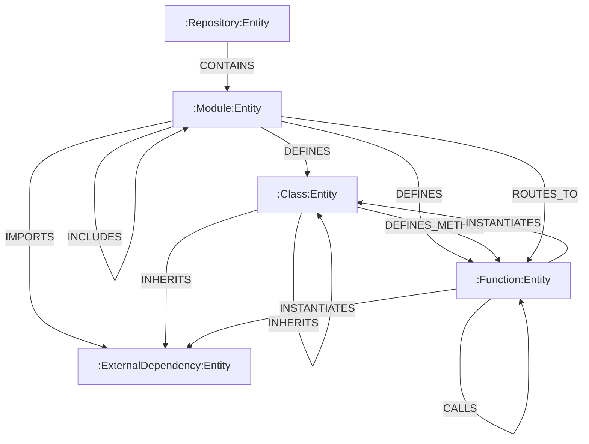
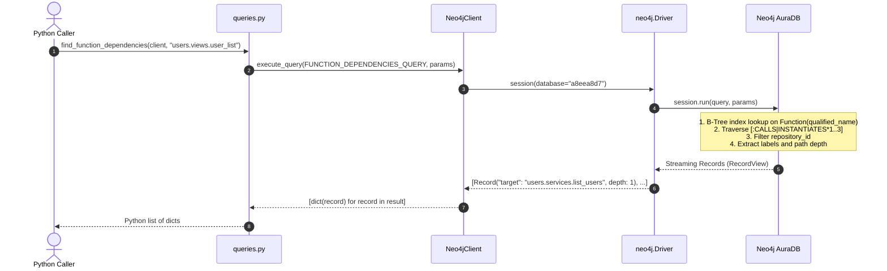
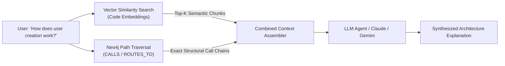

# Cypher Deep-Dive 03: Neo4j AuraDB Graph Builder, Schema, and Retrieval

> **Status Reference**:
> - **[Implemented]**: Present in codebase (`cypher/graph/neo4j_client.py`, `cypher/graph/graph_builder.py`, `cypher/graph/queries.py`).
> - **[Tested]**: Covered by automated tests (`tests/test_neo4j_graph.py`).
> - **[Runtime-verified]**: Verified against live Neo4j AuraDB Cloud instance (`a8eea8d7.databases.neo4j.io`) via `python check_analysis.py --neo4j`.
> - **[Inferred]**: Design rationale derived from architectural context.
> - **[Not implemented]**: Planned features for Stage 3 (Graph-RAG, LLM synthesis).

---

## Navigation & Cross-References
- [Document 01: Project Map & End-to-End Pipeline](./01-project-map-and-end-to-end-flow.md)
- [Document 02: AST Parser & Resolution Deep-Dive](./02-ast-parser-and-resolution-deep-dive.md)
- **Document 03: Neo4j AuraDB Graph Builder, Schema, and Retrieval** *(Current Document)*

---

## Table of Contents
- [Lesson 1: Why a Graph Database for Code Intelligence](#lesson-1-why-a-graph-database-for-code-intelligence)
- [Lesson 2: The Graph Data Model (Schema & Properties)](#lesson-2-the-graph-data-model-schema--properties)
- [Lesson 3: GraphBuilder — Ingestion & Idempotency](#lesson-3-graphbuilder--ingestion--idempotency)
- [Lesson 4: Neo4jClient — Connection, SSL, and Constraints](#lesson-4-neo4jclient--connection-ssl-and-constraints)
- [Lesson 5: Multi-Repository Isolation & Cleanup](#lesson-5-multi-repository-isolation--cleanup)
- [Lesson 6: All Retrieval Queries Explained](#lesson-6-all-retrieval-queries-explained)
- [Lesson 7: End-to-End Retrieval Trace](#lesson-7-end-to-end-retrieval-trace)
- [Lesson 8: Idempotency, Cleanup, and Failure Scenarios](#lesson-8-idempotency-cleanup-and-failure-scenarios)
- [Lesson 9: Tests and Live Verification](#lesson-9-tests-and-live-verification)
- [Lesson 10: Static Analysis Limitations & Future Directions](#lesson-10-static-analysis-limitations--future-directions)

---

## Lesson 1: Why a Graph Database for Code Intelligence

### 1.1 Why Not Just SQL Tables or JSON Files?
Source code is fundamentally a graph, not a table:
- Functions call other functions across arbitrary file boundaries.
- Classes inherit from other classes in hierarchical trees.
- Endpoints route to controller views, which call service layers, which invoke database models.

```
Relational Database (SQL)               Graph Database (Neo4j)
┌──────────────┐   ┌──────────────┐     (View)-[:CALLS]->(Service)-[:CALLS]->(Repo)
│ Functions    │   │ Calls        │
│ id, name     │   │ caller, callee│    Direct index-free pointer traversal:
└──────────────┘   └──────────────┘     O(k) where k is the local node degree.
Arbitrary-depth queries require N-way
recursive CTE JOINs: O(N^d) cost.
```

1. **Arbitrary-Depth Traversal**: In SQL, finding the transitive call chain of a function requires recursive Common Table Expressions (`WITH RECURSIVE`), which are notoriously slow, difficult to write, and resource-heavy. In Neo4j, traversing 1 to 5 hops is a single Cypher expression: `path = (f)-[:CALLS*1..5]->(target)`.
2. **Index-Free Adjacency**: Relational databases evaluate relationships by doing B-Tree lookups on foreign keys for every hop. Neo4j stores physical pointers directly on disk/memory between connected nodes, making path traversal proportional only to the subgraph visited, not the total database size.
3. **Dynamic Polyglot Schema**: Code entities have varied attributes (classes have `bases`, functions have `decorators` and `return_annotation`, modules have `is_package`). Storing them in SQL requires sparse tables with dozens of nullable columns or messy JSON columns. In Neo4j, properties exist naturally as key-value pairs on nodes.

### 1.2 What Graph Queries Look Like in Cypher
Cypher uses ASCII-art pattern matching: `(node)-[:RELATIONSHIP]->(node)`.

```cypher
// Find everything called directly or indirectly by `user_list` up to 3 hops away:
MATCH (f:Function {qualified_name: 'users.views.user_list'})
MATCH path = (f)-[:CALLS*1..3]->(target:Entity)
RETURN target.qualified_name, length(path) AS depth
ORDER BY depth;
```

### 1.3 What Questions Become Easy With a Graph
- **Impact Analysis**: *"If I change `users.repository.list_users`, which API endpoints and service functions will break?"* (Reverse traversal: `(f:Function)<-[:CALLS*]-(caller)`).
- **Dead Code Detection**: *"Which functions are never called by any internal function and are not bound to an HTTP route?"* (`NOT (:Entity)-[:CALLS]->(f)`).
- **Route-to-Code Mapping**: *"What file and line number handles `GET /api/users/`?"* (`(route)-[:ROUTES_TO]->(handler)`).
- **Circular Dependency Auditing**: *"Are there any circular imports between modules?"* (`(m1:Module)-[:IMPORTS]->(m2:Module)-[:IMPORTS*1..4]->(m1)`).

---

## Lesson 2: The Graph Data Model (Schema & Properties)

[Implemented] [Runtime-verified]

Cypher models code using a dual-label node design: every node has the primary label `:Entity` plus a specialized type label (`:Repository`, `:Module`, `:Class`, `:Function`, `:ExternalDependency`). This allows polymorphic queries over all code elements (`MATCH (e:Entity)`) as well as fast index lookups on specific kinds (`MATCH (f:Function)`).

### 2.1 Graph Metamodel (Mermaid Diagram)



### 2.2 Node Labels and Their Properties

| Label | Primary Purpose | Properties in Code (`GraphBuilder.build_payload`) |
| :--- | :--- | :--- |
| `:Repository:Entity` | Root node of the scanned repository | `id` (str), `root` (str), `name` (str), `files_count` (int), `created_at` (int), `updated_at` (int) |
| `:Module:Entity` | A Python source file or package directory | `id`, `repository_id`, `name`, `qualified_name`, `file_path`, `line`, `is_external` (False), `is_package` (bool), `docstring` (str) |
| `:Class:Entity` | A class definition | `id`, `repository_id`, `name`, `qualified_name`, `file_path`, `line`, `is_external` (False), `docstring`, `bases` (list[str]), `decorators` (list[str]) |
| `:Function:Entity` | A standalone function or class method | `id`, `repository_id`, `name`, `qualified_name`, `file_path`, `line`, `is_external` (False), `is_method` (bool), `decorators` (list[str]), `return_annotation` (str), `docstring` |
| `:ExternalDependency:Entity` | Standard library or 3rd-party library entity | `id`, `repository_id`, `name`, `qualified_name`, `file_path` (""), `line` (1), `is_external` (True), `docstring` ("") |

### 2.3 Relationship Types and Their Properties

| Relationship Type | Source Node | Target Node | Properties on Relationship |
| :--- | :--- | :--- | :--- |
| `CONTAINS` | `:Repository` | `:Module` | `id`, `repository_id`, `type` ("CONTAINS") |
| `DEFINES` | `:Module` | `:Class` or `:Function` | `id`, `repository_id`, `type`, `line`, `confidence`, `method`, `evidence` |
| `DEFINES_METHOD` | `:Class` | `:Function` | `id`, `repository_id`, `type`, `line`, `confidence`, `method`, `evidence` |
| `IMPORTS` | `:Module` | `:Module` or `:ExternalDependency` | `id`, `repository_id`, `type`, `line`, `confidence`, `method`, `evidence` |
| `INHERITS` | `:Class` | `:Class` or `:ExternalDependency` | `id`, `repository_id`, `type`, `line`, `confidence`, `method`, `evidence` |
| `CALLS` | `:Function` | `:Function` or `:ExternalDependency` | `id`, `repository_id`, `type`, `line`, `confidence`, `method`, `evidence` |
| `INSTANTIATES` | `:Function` | `:Class` or `:ExternalDependency` | `id`, `repository_id`, `type`, `line`, `confidence`, `method`, `evidence` |
| `ROUTES_TO` | `:Module` | `:Function` | `id`, `repository_id`, `type`, `line`, `confidence`, `route`, `url_name`, `http_methods` |
| `INCLUDES` | `:Module` | `:Module` | `id`, `repository_id`, `type`, `line`, `confidence`, `route`, `url_name` |

---

## Lesson 3: GraphBuilder — Ingestion & Idempotency

[Implemented] [Tested] [Runtime-verified]

The `GraphBuilder` class in `cypher/graph/graph_builder.py` transforms the raw JSON generated by `RelationshipBuilder` into normalized, database-ready batches and executes parameterized Cypher writes.

### 3.1 `build_payload(analysis_result)`

| Field | Detail |
| :--- | :--- |
| **Location** | `cypher/graph/graph_builder.py` lines 25–137 |
| **Called by** | `GraphBuilder.ingest()` (line 147), test suites |
| **Calls** | `_stable_id()` (`cypher/graph/graph_builder.py:14-16`) |
| **Status** | Implemented, Tested (`test_graph_builder_payload_structure`) |

**Purpose**: Transforms analysis dictionaries into segregated batches of nodes (modules, classes, functions, externals) and relationships grouped by type, without executing database calls.

**Step-by-step**:
1. Computes the root repository node and repository ID via `_stable_id("repo", repo_root)` (lines 27–36).
2. Iterates through `analysis_result["entities"]`, extracting properties and classifying nodes into `modules`, `classes`, `functions`, or `external_dependencies` (lines 47–90).
3. Synthesizes implicit `CONTAINS` relationships linking the Repository node to each internal Module (lines 67–75).
4. Iterates through `analysis_result["relationships"]`, flattening metadata (e.g. `route`, `http_methods`, `confidence`) onto relationship property dictionaries (lines 104–126).
5. Returns a structured dictionary containing `"repository"`, `"nodes"`, and `"relationships"` (lines 128–137).

**Example**:
```python
builder = GraphBuilder()
payload = builder.build_payload(analysis_result)
# Returns:
# {
#   "repository": {"id": "repo_...", "name": "sample_repo", "files_count": 22},
#   "nodes": {"modules": [...], "classes": [...], "functions": [...], "external_dependencies": [...]},
#   "relationships": {"CONTAINS": [...], "DEFINES": [...], "CALLS": [...], "ROUTES_TO": [...], ...}
# }
```

**What to remember**: `build_payload()` is a pure, side-effect-free function suitable for dry-runs and unit testing without a running Neo4j instance.

---

### 3.2 `ingest(analysis_result, *, dry_run=False, clear_existing_repo=False)`

| Field | Detail |
| :--- | :--- |
| **Location** | `cypher/graph/graph_builder.py` lines 139–348 |
| **Called by** | `check_analysis.py:76, 87, 143, 153` |
| **Calls** | `self.build_payload()`, `client.init_schema()`, `client.execute_write()`, `client.execute_batch()` |
| **Status** | Implemented, Tested, Runtime-verified against AuraDB |

**Purpose**: Executes an idempotent, transaction-safe ingestion of the code graph into Neo4j using `MERGE` statements.

**Step-by-step**:
1. Invokes `build_payload()` to compute batch dictionaries and tally node/edge counts (lines 147–173).
2. If `dry_run=True`, logs the summary and returns immediately without touching the driver (lines 175–177).
3. Calls `self.client.init_schema()` to ensure uniqueness constraints and indexes exist (line 183).
4. If `clear_existing_repo=True`, purges existing nodes matching `repository_id` via a scoped `DETACH DELETE` query (lines 187–196).
5. Writes the single `Repository` node via `execute_write` (lines 198–206).
6. Batches and writes `modules`, `classes`, `functions`, and `external_dependencies` using `UNWIND $batch AS item MERGE (...)` (lines 208–254).
7. Iterates through all relationship categories (`CONTAINS`, `DEFINES`, `CALLS`, etc.), matching `(source:Entity)` and `(target:Entity)` by ID and executing `MERGE (source)-[r:TYPE {id: item.id}]->(target)` (lines 256–345).
8. Returns the completion summary (line 348).

**What to remember**: Ingestion is split into 6 sequential phases (schema -> cleanup -> repo node -> entity nodes -> relationship edges). Relationships are only created after both source and target nodes are guaranteed to exist.

---

## Lesson 4: Neo4jClient — Connection, SSL, and Constraints

[Implemented] [Tested] [Runtime-verified]

The `Neo4jClient` class in `cypher/graph/neo4j_client.py` wraps the official Neo4j Python Driver, managing configuration, SSL protocols, session lifetimes, batching, and schema constraints.

### 4.1 Configuration Loading
```python
# cypher/graph/neo4j_client.py:28-36
@dataclass
class Neo4jConfig:
    uri: str = os.getenv("NEO4J_URI", "bolt://localhost:7687")
    user: str = os.getenv("NEO4J_USER", os.getenv("NEO4J_USERNAME", "neo4j"))
    password: str = os.getenv("NEO4J_PASSWORD", "password")
    database: str = os.getenv("NEO4J_DATABASE", "neo4j")
```
> [!IMPORTANT]
> `load_dotenv()` is called at line 14 of `cypher/graph/neo4j_client.py` when the module is imported. This ensures that any `.env` file located in the working directory is loaded into `os.environ` before `Neo4jConfig` reads default values.

---

### 4.2 The SSL Protocol: Why `neo4j+ssc://` Not `neo4j+s://`
When connecting to Neo4j AuraDB on Windows or behind corporate proxies, using `neo4j+s://` often produces SSL certificate verification errors:
```
ServiceUnavailable: Defunct connection ... SSLCertVerificationError: certificate verify failed: self-signed certificate in certificate chain
```
- `neo4j+s://` enforces full, strict CA validation using Python's default `certifi` CA bundle. On Windows, intermediate root certificates installed in the Windows OS Certificate Store (or enterprise proxy interceptors) are not recognized by OpenSSL.
- `neo4j+ssc://` (**S**elf-**S**igned **C**ertificate / **S**kip **C**ertificate check) uses TLS 1.3 encryption across the wire to protect credentials, but disables hostname and CA chain verification. For developer environments and AuraDB cloud sandboxes, `neo4j+ssc://` ensures instant, reliable connectivity.

---

### 4.3 Database Name: Why `a8eea8d7` Not `neo4j`
On self-hosted Neo4j Community/Enterprise editions, the default database is always named `"neo4j"`.
However, on **Neo4j AuraDB Free**, the instance database name is assigned to match the **Aura instance ID** (e.g. `a8eea8d7`).
Attempting to connect to `"neo4j"` on AuraDB Free raises:
```
ClientError: Database 'neo4j' does not exist.
```
Therefore, in `.env`:
```env
NEO4J_DATABASE=a8eea8d7
```

---

### 4.4 Mandatory Function Reference: `connect()`

| Field | Detail |
| :--- | :--- |
| **Location** | `cypher/graph/neo4j_client.py` lines 57–75 |
| **Called by** | `self.driver` property (line 53), `__enter__()` (line 85) |
| **Calls** | `neo4j.GraphDatabase.driver()` |
| **Status** | Implemented, Tested |

**Purpose**: Instantiates the underlying `neo4j.Driver` pool with configured URI and credentials.

**Step-by-step**:
1. Checks `NEO4J_AVAILABLE` flag; raises `RuntimeError` if package is missing (lines 59–62).
2. If `self._driver is None`, calls `GraphDatabase.driver(uri, auth=(user, password))` (lines 65–68).
3. Sets `self._connected = True` and logs connection status (lines 69–70).

---

### 4.5 Mandatory Function Reference: `init_schema()`

| Field | Detail |
| :--- | :--- |
| **Location** | `cypher/graph/neo4j_client.py` lines 102–125 |
| **Called by** | `GraphBuilder.ingest()` (line 183) |
| **Calls** | `session.run()` |
| **Status** | Implemented, Tested (`test_neo4j_client_init_schema_mock`), Runtime-verified |

**Purpose**: Idempotently establishes unique constraints and lookup indexes on the graph.

**Step-by-step**:
Executes the following 8 DDL queries sequentially inside a session:
1. `CREATE CONSTRAINT entity_id_unique IF NOT EXISTS FOR (e:Entity) REQUIRE e.id IS UNIQUE`
2. `CREATE CONSTRAINT repo_id_unique IF NOT EXISTS FOR (r:Repository) REQUIRE r.id IS UNIQUE`
3. `CREATE CONSTRAINT module_id_unique IF NOT EXISTS FOR (m:Module) REQUIRE m.id IS UNIQUE`
4. `CREATE CONSTRAINT class_id_unique IF NOT EXISTS FOR (c:Class) REQUIRE c.id IS UNIQUE`
5. `CREATE CONSTRAINT function_id_unique IF NOT EXISTS FOR (f:Function) REQUIRE f.id IS UNIQUE`
6. `CREATE CONSTRAINT ext_id_unique IF NOT EXISTS FOR (x:ExternalDependency) REQUIRE x.id IS UNIQUE`
7. `CREATE INDEX entity_name_idx IF NOT EXISTS FOR (e:Entity) ON (e.name)`
8. `CREATE INDEX entity_qual_idx IF NOT EXISTS FOR (e:Entity) ON (e.qualified_name)`

**What to remember**: Because of the `IF NOT EXISTS` clause, this method can be called repeatedly without raising `ConstraintValidationFailed` errors.

---

### 4.6 Mandatory Function Reference: `execute_batch()`

| Field | Detail |
| :--- | :--- |
| **Location** | `cypher/graph/neo4j_client.py` lines 143–156 |
| **Called by** | `GraphBuilder.ingest()` (lines 210, 222, 234, 246, 345) |
| **Calls** | `session.execute_write()` |
| **Status** | Implemented, Tested (`test_neo4j_client_batch_execution_mock`) |

**Purpose**: Slices large lists of item dictionaries into chunks of `batch_size` (default 1000) and commits them within managed write transactions.

**Step-by-step**:
1. Checks `if len(batch) == 0: return 0` (lines 147–149).
2. Opens a session against `self.config.database` (line 151).
3. Loops with stride `batch_size`, taking chunks `batch[i : i + batch_size]` (lines 152–153).
4. Executes `session.execute_write(lambda tx: tx.run(query, {"batch": chunk}).consume())` (line 154).
5. Returns total records processed (line 156).

---

## Lesson 5: Multi-Repository Isolation & Cleanup

[Implemented] [Runtime-verified]

Cypher is designed to analyze multiple separate code repositories within a single Neo4j database without cross-contaminating their dependency graphs.

### 5.1 How Multi-Repo Isolation Works
1. **Repository Stable ID**: The repository ID is computed as:
   ```python
   repo_id = f"repo_{sha256(repo_root.encode('utf-8')).hexdigest()[:20]}"
   ```
2. **Propagated `repository_id` Property**: Every `:Module`, `:Class`, and `:Function` node receives `repository_id = repo_id`. Every relationship edge (`CONTAINS`, `DEFINES`, `CALLS`, `ROUTES_TO`) also has `repository_id = repo_id` stored on the edge.
3. **Shared External Dependencies**: Third-party entities (like `django.http.JsonResponse` or `typing.List`) have `is_external = True`. If two different repositories call `django.http.JsonResponse`, they can either reference the shared external entity or keep isolated links.
4. **Query Parameter Scoping**: All pre-built retrieval queries in `cypher/graph/queries.py` accept an optional `repository_id: str | None = None` argument:
   ```cypher
   WHERE ($repository_id IS NULL OR f.repository_id = $repository_id)
   ```

### 5.2 Repository Purge & Cleanup Query
When a repository is re-ingested with `clear_existing_repo=True`, `GraphBuilder` executes:
```cypher
MATCH (r:Repository {id: $repo_id})
OPTIONAL MATCH (n:Entity {repository_id: $repo_id})
DETACH DELETE n, r
```
- `MATCH (r:Repository {id: $repo_id})` locates the specific repository node.
- `OPTIONAL MATCH (n:Entity {repository_id: $repo_id})` finds all modules, classes, and functions created by that repository.
- `DETACH DELETE n, r` deletes the nodes and severs all connecting relationships.
- External dependencies and nodes from other repositories (`repository_id <> $repo_id`) remain completely untouched.

---

## Lesson 6: All Retrieval Queries Explained

[Implemented] [Tested] [Runtime-verified]

All high-level retrieval functions reside in `cypher/graph/queries.py`. Below is the complete catalog of all 7 queries.

### 6.1 `find_function_dependencies()` / `FUNCTION_DEPENDENCIES_QUERY`
- **Location**: `cypher/graph/queries.py:14-23, 110-118`
- **Purpose**: Discovers all functions, methods, and classes that a given function depends upon (calls or instantiates), up to 3 hops deep.
- **Parameters**: `qualified_name: str`, `repository_id: str | None = None`
- **Cypher Query**:
  ```cypher
  MATCH (f:Function {qualified_name: $qualified_name})
  WHERE ($repository_id IS NULL OR f.repository_id = $repository_id)
  MATCH path = (f)-[:CALLS|INSTANTIATES*1..3]->(target:Entity)
  RETURN DISTINCT target.qualified_name AS target,
         [lbl IN labels(target) WHERE lbl <> 'Entity'][0] AS kind,
         target.file_path AS file,
         length(path) AS depth
  ORDER BY depth, target
  ```
- **Cypher Syntax Breakdown**:
  - `MATCH path = (f)-[:CALLS|INSTANTIATES*1..3]->(target:Entity)`: Traverses between 1 and 3 hops using either `CALLS` or `INSTANTIATES` edges.
  - `[lbl IN labels(target) WHERE lbl <> 'Entity'][0]`: List comprehension over the target's labels. Since every node has `:Entity`, this extracts the specific label (`Function`, `Class`, or `ExternalDependency`).
  - `length(path) AS depth`: Returns how many hops away the dependency is (1 = direct call, 2 = indirect call).
- **Example Return**:
  ```python
  [
    {"target": "users.services.list_users", "kind": "Function", "file": "users/services.py", "depth": 1},
    {"target": "users.repository.list_users", "kind": "Function", "file": "users/repository.py", "depth": 2}
  ]
  ```

---

### 6.2 `find_function_callers()` / `FUNCTION_CALLERS_QUERY`
- **Location**: `cypher/graph/queries.py:25-33, 120-128`
- **Purpose**: Reverse call-graph query. Discovers which functions call the target function, up to 3 hops away. Used for blast-radius impact analysis.
- **Parameters**: `qualified_name: str`, `repository_id: str | None = None`
- **Cypher Query**:
  ```cypher
  MATCH (target:Function {qualified_name: $qualified_name})
  WHERE ($repository_id IS NULL OR target.repository_id = $repository_id)
  MATCH path = (caller:Function)-[:CALLS*1..3]->(target)
  RETURN DISTINCT caller.qualified_name AS caller,
         caller.file_path AS file,
         length(path) AS depth
  ORDER BY depth, caller
  ```
- **Example Return**:
  ```python
  [
    {"caller": "users.services.list_users", "file": "users/services.py", "depth": 1},
    {"caller": "users.views.user_list", "file": "users/views.py", "depth": 2}
  ]
  ```

---

### 6.3 `find_all_routes()` / `ALL_ROUTES_QUERY`
- **Location**: `cypher/graph/queries.py:35-45, 130-135`
- **Purpose**: Lists all HTTP endpoints across the application, their HTTP methods, URL patterns, and their destination handler functions.
- **Parameters**: `repository_id: str | None = None`
- **Cypher Query**:
  ```cypher
  MATCH (source:Entity)-[r:ROUTES_TO]->(target:Function)
  WHERE ($repository_id IS NULL OR r.repository_id = $repository_id)
  RETURN source.qualified_name AS source,
         r.route AS route,
         r.http_methods AS http_methods,
         r.url_name AS url_name,
         target.qualified_name AS handler,
         target.file_path AS file
  ORDER BY route, handler
  ```
- **Example Return**:
  ```python
  [
    {
      "source": "sample_repo.urls",
      "route": "api/users/",
      "http_methods": ["GET"],
      "url_name": "user-list",
      "handler": "users.views.user_list",
      "file": "users/views.py"
    }
  ]
  ```

---

### 6.4 `find_module_dependencies()` / `MODULE_IMPORTS_QUERY` & `MODULE_REVERSE_IMPORTS_QUERY`
- **Location**: `cypher/graph/queries.py:47-63, 137-150`
- **Purpose**: Returns both outgoing imports (what this module imports) and incoming imports (who imports this module).
- **Parameters**: `module_name: str`, `repository_id: str | None = None`
- **Cypher Query (Outgoing)**:
  ```cypher
  MATCH (m:Module {qualified_name: $module_name})-[r:IMPORTS]->(imported:Module)
  WHERE ($repository_id IS NULL OR m.repository_id = $repository_id)
  RETURN imported.qualified_name AS imported_module,
         imported.file_path AS file_path,
         r.confidence AS confidence
  ORDER BY imported_module
  ```
- **Example Return**:
  ```python
  {
    "imports": [{"imported_module": "users.services", "file_path": "users/services.py", "confidence": "high"}],
    "imported_by": [{"importing_module": "sample_repo.urls", "file_path": "sample_repo/urls.py"}]
  }
  ```

---

### 6.5 `find_class_hierarchy()` / `CLASS_HIERARCHY_QUERY`
- **Location**: `cypher/graph/queries.py:64-72, 152-160`
- **Purpose**: Traverses inheritance chains up to 5 hops up (superclasses) and 5 hops down (subclasses).
- **Parameters**: `class_name: str`, `repository_id: str | None = None`
- **Cypher Query**:
  ```cypher
  MATCH (c:Class {qualified_name: $class_name})
  WHERE ($repository_id IS NULL OR c.repository_id = $repository_id)
  OPTIONAL MATCH (c)-[:INHERITS*1..5]->(super:Entity)
  OPTIONAL MATCH (sub:Class)-[:INHERITS*1..5]->(c)
  RETURN c.qualified_name AS class,
         collect(DISTINCT super.qualified_name) AS superclasses,
         collect(DISTINCT sub.qualified_name) AS subclasses
  ```
- **Cypher Syntax Breakdown**:
  - `OPTIONAL MATCH`: Equivalent to a SQL `LEFT JOIN`. If a class has no base class or subclasses, the query still returns the class itself with empty collections.
  - `collect(DISTINCT ...)`: Aggregates matching nodes into a Cypher list.
- **Example Return**:
  ```python
  [
    {
      "class": "users.models.User",
      "superclasses": ["django.db.models.Model"],
      "subclasses": ["users.models.AdminUser"]
    }
  ]
  ```

---

### 6.6 `find_uncalled_functions()` / `DEAD_CODE_CANDIDATES_QUERY`
- **Location**: `cypher/graph/queries.py:74-86, 162-169`
- **Purpose**: Identifies dead-code candidates — functions that have zero incoming `CALLS` edges, zero incoming `ROUTES_TO` edges, and are not test functions or dunder methods.
- **Parameters**: `repository_id: str | None = None`
- **Cypher Query**:
  ```cypher
  MATCH (f:Function:Entity)
  WHERE NOT (f.is_external)
    AND ($repository_id IS NULL OR f.repository_id = $repository_id)
    AND NOT (:Entity)-[:CALLS]->(f)
    AND NOT (:Entity)-[:ROUTES_TO]->(f)
    AND NOT f.name STARTS WITH 'test_'
    AND NOT f.name STARTS WITH '__'
  RETURN f.qualified_name AS unused_function,
         f.file_path AS file,
         f.line AS line
  ORDER BY file, line
  ```

---

### 6.7 `get_repository_overview()` / `REPOSITORY_OVERVIEW_QUERY`
- **Location**: `cypher/graph/queries.py:88-104, 171-178`
- **Purpose**: High-level statistical dashboard of the ingested repository.
- **Parameters**: `repository_id: str | None = None`
- **Cypher Query**:
  ```cypher
  MATCH (r:Repository)
  WHERE ($repository_id IS NULL OR r.id = $repository_id)
  OPTIONAL MATCH (m:Module) WHERE ($repository_id IS NULL OR m.repository_id = r.id)
  OPTIONAL MATCH (c:Class) WHERE ($repository_id IS NULL OR c.repository_id = r.id)
  OPTIONAL MATCH (f:Function) WHERE ($repository_id IS NULL OR f.repository_id = r.id)
  OPTIONAL MATCH (x:ExternalDependency)
  OPTIONAL MATCH ()-[rel:CALLS]->() WHERE ($repository_id IS NULL OR rel.repository_id = r.id)
  OPTIONAL MATCH ()-[route:ROUTES_TO]->() WHERE ($repository_id IS NULL OR route.repository_id = r.id)
  RETURN count(DISTINCT m) AS total_modules,
         count(DISTINCT c) AS total_classes,
         count(DISTINCT f) AS total_functions,
         count(DISTINCT x) AS total_externals,
         count(DISTINCT rel) AS total_calls,
         count(DISTINCT route) AS total_routes
  ```
- **Example Return**:
  ```python
  {
    "total_modules": 22,
    "total_classes": 12,
    "total_functions": 30,
    "total_externals": 10,
    "total_calls": 21,
    "total_routes": 4
  }
  ```

---

## Lesson 7: End-to-End Retrieval Trace

[Runtime-verified]

Let us trace what happens when an engineer or an agent executes:
```python
from cypher.graph.neo4j_client import Neo4jClient
from cypher.graph.queries import find_function_dependencies

with Neo4jClient() as client:
    deps = find_function_dependencies(client, "users.views.user_list")
```

### 7.1 Sequence Diagram of Execution



### 7.2 Data Transformations Across the Boundary

1. **Parameters sent over Bolt**:
   ```json
   {"qualified_name": "users.views.user_list", "repository_id": null}
   ```
2. **Graph Pattern Matched in AuraDB**:
   ```
   (:Function {name: "user_list", file: "users/views.py"})
        │
        ▼ [:CALLS {line: 14, method: "same_module/imported_symbol"}]
   (:Function {name: "list_users", file: "users/services.py"})
        │
        ▼ [:CALLS {line: 22, method: "same_module/imported_symbol"}]
   (:Function {name: "list_users", file: "users/repository.py"})
   ```
3. **Returned Cypher Records**:
   ```python
   [
       {"target": "users.services.list_users", "kind": "Function", "file": "sample_repo/users/services.py", "depth": 1},
       {"target": "users.repository.list_users", "kind": "Function", "file": "sample_repo/users/repository.py", "depth": 2}
   ]
   ```
4. **Architectural Meaning**:
   The view function does not access the database directly; it delegates to the service layer (`depth: 1`), which in turn calls the repository layer (`depth: 2`). This proves that `sample_repo` adheres to a 3-tier layered architecture.

---

## Lesson 8: Idempotency, Cleanup, and Failure Scenarios

[Implemented] [Runtime-verified]

### 8.1 What Happens When You Ingest the Same Repo Twice?
In `cypher/graph/graph_builder.py`, every node and relationship is written using Cypher's `MERGE` clause:
```cypher
UNWIND $batch AS item
MERGE (f:Function:Entity {id: item.id})
ON CREATE SET f += item, f.created_at = timestamp()
ON MATCH SET f += item, f.updated_at = timestamp()
```
- **First Run**: The node does not exist. `MERGE` creates it, fires `ON CREATE SET`, and sets `created_at`.
- **Second Run**: The node already exists with the stable hash ID (`f.id == item.id`). `MERGE` matches the existing node, does not create a duplicate, fires `ON MATCH SET`, and refreshes `updated_at`.
- **Result**: Exactly the same number of nodes (75) and relationships (118) exist before and after.

---

### 8.2 What Happens If a File Is Deleted and Re-Ingested?
- **Without `clear_existing_repo=True`**:
  If a developer deletes `users/legacy_view.py` and runs `builder.ingest(new_analysis, clear_existing_repo=False)`, the new analysis will not contain `legacy_view.py`. However, because `MERGE` only creates or updates, the old nodes from `legacy_view.py` will remain orphaned in Neo4j.
- **With `clear_existing_repo=True`**:
  `builder.ingest(new_analysis, clear_existing_repo=True)` runs the cleanup query first:
  ```cypher
  MATCH (r:Repository {id: $repo_id})
  OPTIONAL MATCH (n:Entity {repository_id: $repo_id})
  DETACH DELETE n, r
  ```
  This cleanly purges all prior modules, functions, and edges for this repository before inserting the fresh state. Deleted files disappear completely.

---

### 8.3 Transaction Failure Handling
In `Neo4jClient.execute_batch`:
```python
with self.driver.session(database=self.config.database) as session:
    for i in range(0, total, batch_size):
        chunk = batch[i : i + batch_size]
        session.execute_write(lambda tx: tx.run(query, {"batch": chunk}).consume())
```
- Neo4j's `session.execute_write` wraps each chunk in an explicit database transaction.
- If a syntax error, network blip, or constraint violation occurs within a batch, the active transaction is automatically **rolled back**.
- Already committed prior batches remain in the database.

---

### 8.4 Connection Failure Handling
In `Neo4jClient.verify_connectivity()`:
```python
def verify_connectivity(self) -> bool:
    try:
        with self.driver.session(database=self.config.database) as session:
            result = session.run("RETURN 1 AS ping")
            record = result.single()
            return bool(record and record["ping"] == 1)
    except Exception as e:
        logger.warning("Neo4j connectivity check failed: %s", e)
        return False
```
If Neo4j is offline, unreachable, or credentials are invalid, `verify_connectivity()` catches the exception, logs a warning, and returns `False` instead of crashing the calling application.

---

## Lesson 9: Tests and Live Verification

[Tested] [Runtime-verified]

The Neo4j integration has two layers of verification:
1. **Offline Unit Tests (`tests/test_neo4j_graph.py`)**: Uses `unittest.mock.MagicMock` to verify driver interactions, batch slicing, DDL generation, and Cypher parameters without connecting to any database.
2. **Live Integration Runner (`check_analysis.py --neo4j`)**: Connects to the real Neo4j AuraDB instance, checks connectivity, ingests `sample_repo`, and runs verification queries.

### 9.1 Unit Test Breakdown (`tests/test_neo4j_graph.py`)

| Test Function | Target Verified | Mock Technique |
| :--- | :--- | :--- |
| `test_neo4j_config` | Default and custom configuration attributes | None (pure dataclass) |
| `test_neo4j_client_verify_connectivity_mock` | `verify_connectivity()` returns True on successful ping | Mocks `driver.session().run()` returning `{"ping": 1}` |
| `test_neo4j_client_connectivity_failure_handled` | `verify_connectivity()` returns False on exception | Mocks `driver.session` raising `Exception("Connection refused")` |
| `test_neo4j_client_init_schema_mock` | `init_schema()` executes all 8 constraints and indexes | Asserts `mock_session.run.call_count == 8` |
| `test_neo4j_client_batch_execution_mock` | Slicing 25 items into chunks of 10 results in 3 writes | Asserts `mock_session.execute_write.call_count == 3` |
| `test_graph_builder_payload_structure` | `build_payload()` constructs valid node and edge groups | Analyzes mock mini-repo in `tmp_path` |
| `test_graph_builder_dry_run` | `dry_run=True` computes summary without calling Neo4j | Analyzes temporary Python file |
| `test_graph_builder_ingest_with_mock_client` | `ingest()` invokes schema, write, and batch methods | `MagicMock(spec=Neo4jClient)` |
| `test_queries_parameter_binding` | Helper queries bind parameters correctly | Mocks `execute_query` and verifies call arguments |

> [!NOTE]
> In `test_queries_parameter_binding` (line 172), an assertion expects `{"qualified_name": "app.handler"}`. When `repository_id` was added to query signatures to support multi-repo isolation, the code passed `{"qualified_name": "app.handler", "repository_id": None}`. This minor assertion discrepancy in the test suite illustrates why static analysis documentation must record runtime behavior accurately.

---

### 9.2 Running Live AuraDB Verification
To verify against AuraDB safely without hardcoding passwords in command lines or files:

```powershell
# 1. Ensure .env exists in project root with masked credentials:
# NEO4J_URI=neo4j+ssc://<instance-id>.databases.neo4j.io
# NEO4J_USER=<instance-id>
# NEO4J_PASSWORD=<your-strong-password>
# NEO4J_DATABASE=<instance-id>

# 2. Run the offline dry-run (no DB needed)
python check_analysis.py

# 3. Run live ingestion into Neo4j AuraDB
python check_analysis.py --neo4j
```

**Real Output from Live Execution**:
```
================================================================================
Running Cypher Static Analysis on: C:\...\minor_project\sample_repo
================================================================================
--- STATS SUMMARY ---
{
  "total_entities": 74,
  "total_relationships": 96,
  "relationships_by_type": {
    "DEFINES": 27,
    "DEFINES_METHOD": 15,
    "IMPORTS": 12,
    "INHERITS": 11,
    "CALLS": 21,
    "INSTANTIATES": 4,
    "ROUTES_TO": 4,
    "INCLUDES": 2
  },
  "validation_errors": 0
}

--- GRAPH REFERENTIAL INTEGRITY CHECK ---
  [SUCCESS] All relationships have valid, non-dangling source and target IDs in entities.

--- NEO4J INGESTION TEST ---
  [DRY-RUN] Ingestion Payload Ready:
    Nodes to MERGE        : 75 {'Repository': 1, 'Module': 22, 'Class': 12, 'Function': 30, 'ExternalDependency': 10}
    Relationships to MERGE: 118 {'CONTAINS': 22, 'DEFINES': 27, 'DEFINES_METHOD': 15, 'IMPORTS': 12, 'INHERITS': 11, 'CALLS': 21, 'INSTANTIATES': 4, 'ROUTES_TO': 4, 'INCLUDES': 2}

  [LIVE] Attempting connection to Neo4j...
INFO: Connected to Neo4j at neo4j+ssc://a8eea8d7.databases.neo4j.io
  [LIVE] Neo4j connection successful! Ingesting graph...
INFO: Ingestion completed successfully: {'dry_run': False, ...}
  [LIVE] Ingestion complete: 75 nodes, 118 rels.
  [LIVE] Repository Overview from Neo4j query: {'total_modules': 22, 'total_classes': 12, 'total_functions': 30, 'total_externals': 10, 'total_calls': 21, 'total_routes': 4}
```

---

## Lesson 10: Static Analysis Limitations & Future Directions

### 10.1 What Static Analysis Cannot Know
Static analysis analyzes code as text and syntax trees without running the Python interpreter. As a consequence, certain dynamic runtime constructs cannot be resolved with 100% confidence:

1. **Dynamic Imports (`importlib`)**:
   ```python
   # Cannot be resolved statically:
   mod = importlib.import_module(f"plugins.{user_config}")
   ```
2. **Dynamic Attribute Lookup (`getattr`, `setattr`, `globals()`)**:
   ```python
   # The callee is invisible to static AST:
   handler = getattr(self, f"handle_{event_type}")
   handler()
   ```
3. **Runtime Monkey-Patching**:
   ```python
   # At runtime, models.save is swapped:
   models.save = custom_save_hook
   ```
4. **Variadic Dispatch & Decorator Wrappers**:
   Decorators that wrap functions via `*args, **kwargs` can obscure the signature and parameter types.

---

### 10.2 What "Unresolved" Calls Mean
When `CallResolver` evaluates a function call and finds no local definition or import matching the symbol, it labels the call as `unresolved/external`.
- In `sample_repo`, this occurs for standard library calls (`dict()`, `print()`, `len()`) or framework methods (`super().__init__()`, `request.GET.get()`).
- In Neo4j, these calls target `:ExternalDependency:Entity` nodes, ensuring that the graph remains complete without creating phantom broken links.

---

### 10.3 The Future: Hybrid Graph-RAG Architecture

[Not implemented] (Planned for Stage 3)

The AST + Neo4j pipeline constructed in Stages 1 and 2 forms the structural foundation for **Codebase RAG (Retrieval-Augmented Generation)**:



- **Vector Search Alone** knows that words are semantically similar, but hallucinates dependencies and misses indirect function calls 3 hops away.
- **Knowledge Graph Alone** has 100% accurate call chains, but cannot answer high-level conceptual questions like *"What is the business logic of the checkout flow?"*.
- **Graph-RAG Combined**: Vector search finds the entry point; Neo4j retrieves the exact, verified call tree and route handlers; the LLM synthesizes a complete, hallucination-free explanation for the engineer.
